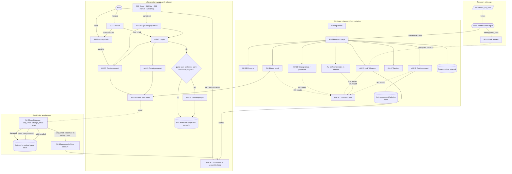

# Accounts, linking, names, deletion and the web shop (v6)

> **Status**: In Review (P2-UX-ACCT)
> **Author**: ux-designer (autonomous v6 run)
> **Last Updated**: 2026-10-13
> **Platform Target**: play.pixelarrow.app on the web (phone portrait, phone landscape, tablet, laptop with mouse and keyboard) and the Telegram Mini App (touch, portrait first). The landing footer on pixelarrow.app for flow 8 only.
> **Template**: UX Spec (flow)
> **Accessibility tier**: Standard (V5-013, `design/accessibility-requirements.md`)
> **Follows**: ADR-0006 (platform layer: `Auth`, `Payments`), ADR-0007 (hosting), ADR-0008 (accounts and sessions), ADR-0009 (linking, names, deletion), ADR-0010 (public boards), `docs/v6/plan/CONTROL_MANIFEST_ACCOUNTS.md`, V6-011, V6-014. Brief goals 5–9.
> **Kit**: `docs/UI_KIT.md` (Mosaic), `design/ux/interaction-patterns.md` (P1–P26), `design/ux/screen-flow.md` (S01–S24).

This spec is the UX source the accounts, linking, nickname, deletion, privacy and web-payments stories build against. Where it says *must*, a reviewer checks it. It never overrides an ADR: where the UX needed something the ADRs don't give, it is listed in §14 for the architects, not assumed.

---

## 0. Decisions made in this spec

| ID | Decision | Alternatives | Why |
| --- | --- | --- | --- |
| UXA-01 | **Guest play is allowed on the web.** A first-time web visitor lands in the game exactly as a Telegram player does (first run, tutorial, campaign) with no account wall. A guest has **no server player**: progress lives in this browser's `localStorage` only. | (a) An account wall before play. (b) Anonymous server accounts for guests. | (a) The landing page's "Play in browser" must reach a battle in seconds; a sign-up wall before the first fight is the biggest drop-off point in any funnel, and ADR-0008 Alt 5 already counts on "play the offline campaign without an account while they wait". (b) Anonymous server rows break N-ID-1/M-ID-2 (identities only after proof), need their own abuse limits and their own deletion path, and add nothing the local save doesn't already give. |
| UXA-02 | **What a guest can do** = what works with no server today: the campaign (Boot, First run, Campaign hub, World, Camp, Settlement, Army, Hero, Battle, Results), the Codex with its beast trials, and Settings. **What needs an account:** Duels (ladder too: the duel army lives on the server), War (map, army, clan, merchants), Market, Shop (cosmetics, pass, wallet), cloud save, notifications, public leaderboards. Each of those shows the *Sign in to play online* state (AU-01), never a dead end. | Let guests play the ladder locally | The ladder's army and rewards are server-owned (`duels.outsideHint`); a local copy would fork the economy. |
| UXA-03 | **A guest's campaign comes with them.** Creating an account (or logging in to an account with no campaign) uploads the guest save to it. Logging in to an account that already has a campaign, on a device whose guest save also has progress, asks once which campaign to keep on this device (AU-08). | Silent "more progress wins" (today's `decideOnLoad`) | A silent overwrite of a guest's afternoon of play is the worst first impression an account can make. The choice is about the campaign save only; it never merges or deletes accounts. |
| UXA-04 | **Sign-in UI is capability-gated, never platform-gated.** Email forms appear only when `platform.auth.methods()` includes `'password'` (the web). The Telegram adapter signs in silently and never shows a log-in screen. Account management (name, add email, devices, delete) reads `GET /api/account` and works on both. | `if (telegram)` | The platform rule (ADR-0006, brief goal 4). |
| UXA-05 | **Auth forms are HTML forms over the canvas** (`AuthForm`, a new component that grows out of `textInput.ts`, pattern P26), not Phaser drawings. | Canvas-drawn fields | Password managers, autofill (`autocomplete="email" / "current-password" / "new-password"`), the phone keyboard, paste, screen readers and the Turnstile iframe all need real DOM inputs. The canvas cannot host a Turnstile widget. |
| UXA-06 | **Email-link pages are small standalone pages** in the game build (`/auth/signup`, `/auth/add_email`, `/auth/change_email`, `/auth/reset`), styled like the kit, with no Phaser. They consume the `#t=` token, show the result, then hand over to the game (`/`). | Boot the whole game on `/auth/*` | A link opened from a phone mail app lands in an in-app browser: the page must show "Email confirmed" in under a second, with no 4 MB game load, and the reset form must be a real page for password managers. Same origin, so the cookie it receives signs the game in. |
| UXA-07 | **No "confirm password" field.** Every password field has a show/hide eye instead; the policy hint is live. | Type it twice | NIST SP 800-63B guidance, which ADR-0008 follows; a second field doubles typing on a phone and catches fewer errors than "show". |
| UXA-08 | **Uniform replies are worded so they are true in every case**: "If {email} can be used, a link is on its way" style copy, never "Account created" or "No account with that email". | Friendly but revealing copy | N-AF-2. |
| UXA-09 | **The client counts its own failed log-ins.** The server's lockout returns the same `401 invalid_credentials` (M-AF-3), so after 5 consecutive failures *in this form* the client shows the generic "Too many attempts" copy and suggests a reset. It never claims to know the account is locked. | Ask the server for lock state | The server must not reveal it. |
| UXA-10 | **The rename offer comes the first time a signed-in player opens Duels or War** (a one-time *Your name* sheet), and as a line on First run's Modes step when signed in. Not inside the tutorial. | A name step in the tutorial | Names only matter where other players see them; the tutorial stays the shortest path to the first battle. ADR-0009 §6 "the first run offers a rename" is met by the Modes line. |
| UXA-11 | **Deletion clears this device too.** After a successful delete, the device's campaign save, sync metadata and pending-email record are wiped and the game returns to the first run as a guest (web) or shows a closing card (Telegram). Settings that are not account data (language, sound, motion) stay. | Keep the local campaign | Otherwise the "deleted" account's campaign keeps playing on the device, which reads as "it didn't work". |
| UXA-12 | **The web wallet lists the packs with a "Coming soon" reason card and no prices.** Cosmetics and the season pass (paid in Drachmae) work on the web once signed in. | Hide the wallet tab; show Stars prices | Hiding removes information (brief: no silent removal). Stars prices are meaningless off Telegram and would read as a price list we can't honour. Real-money pricing is unchanged. |

---

## 1. Rules shared by every account screen

These add to `design/ux/screens-campaign.md` §0 ("Rules shared by every screen"); they don't replace it.

### 1.1 Two surfaces

| Surface | Used for | Built with |
| --- | --- | --- |
| **Canvas** (Phaser, Mosaic kit) | everything that shows state or asks a yes/no: the Account page, devices, conflict summaries, confirmations, the shop states, the signed-out state | `openParchmentSheet`, `ParchmentRow`, `MButton`, `confirmDialog`, `addParchmentEmpty` / `addEconState`, `addTipLine` |
| **HTML form** (`AuthForm`, §12) | everything you type into: log-in, sign-up, forgot password, re-auth, add or change email, change password, rename, the typed confirmations (conflict, delete) | DOM inside `#px-prompt`, dressed in the kit's CSS (today's `textInput.ts` look) |
| **Standalone page** (`/auth/*`) | opening an email link | static HTML + a small script; the kit's CSS; no Phaser |

A form opens **over** the canvas screen that asked for it, with the 45% basalt scrim (P25). Back (Telegram or the in-game arrow), Escape and Cancel close it; a tap on the scrim does **not** (it's a form, as `textInput.ts` does today). At most one form at a time; a form never opens over another form: a form that leads to another (log-in → forgot password) **replaces** its content in place, and Back returns to the previous form with its fields kept.

### 1.2 Form behaviour (every `AuthForm`)

- **Labels above fields**, always visible (never placeholder-only). Placeholder only as an example ("name@example.com").
- **Field types and autocomplete:** email `type="email" inputmode="email" autocomplete="email" autocapitalize="off" spellcheck="false"`; new password `type="password" autocomplete="new-password"`; current password `autocomplete="current-password"`; nickname `autocomplete="nickname" autocapitalize="off"`. Inputs at 16 CSS px so iOS doesn't zoom.
- **Show / hide password:** an eye button inside the field's right edge, 44 px hit box, `aria-pressed`, label "Show password" / "Hide password". Off by default.
- **Validation:** client checks run on blur and on submit, never on every keystroke while the field is still being typed in (except the password length hint, which counts live). The server's answer is authoritative; its errors show in the same places.
- **Where errors go:** a field error sits under its field (`bad` ink, an ⚠ icon, never colour alone) and the field gets a red rim; a form error (credentials, rate limit, network) sits in one banner above the submit button. Both are in an `aria-live="polite"` region and the first invalid field takes focus.
- **Submit:** the one terracotta button, full width, bottom of the form. While waiting it shows a spinner and "Working…" in its label, stays the same size, and ignores further presses. A second submit is impossible.
- **Enter submits** from the last field; Enter in an earlier field moves to the next field (the browser's default for one-field-at-a-time forms is fine; don't intercept Tab).
- **Keyboard:** Tab order is fields top to bottom, then links in reading order, then Cancel, then Submit. First field focused on open (not on phones in landscape, where the keyboard would cover the form: there the form opens unfocused and scrolled to the top).
- **Fields are kept** when a form fails, except password fields after a `401 invalid_credentials` (cleared, focused).

### 1.3 Turnstile (web only: sign-up, log-in, forgot password, resend)

- **Mode:** managed, `appearance: 'interaction-only'`, `size: 'flexible'`, theme `dark`, language from the game language. In most cases nobody sees it.
- **Slot:** a 65 px high reserved box directly above the form banner and the submit button, so a challenge that does appear never pushes the button under the keyboard or causes layout shift. When no challenge is shown, the slot collapses after the token arrives (animated height, instant under Reduce motion).
- **Timing:** the widget renders when the form opens. If Submit is pressed before a token exists, the button shows "Checking your browser…" and the form submits by itself the moment the token arrives (at most 10 s, then the *timeout* error below).
- **Errors:**

| Case | What the player sees | Recovery |
| --- | --- | --- |
| Widget failed to load (blocked script, offline) | banner `auth.err.turnstileLoad` | Retry link re-renders the widget |
| Challenge failed or timed out client-side | banner `auth.err.turnstile` | `turnstile.reset()`, the player presses Submit again |
| Server `400 turnstile_failed` | banner `auth.err.turnstile` | same, automatic reset |
| Server `503` (siteverify down; fails closed) | banner `auth.err.unavailable` | "Try again" after a few minutes |
| Token expired (after 300 s idle) | nothing visible | the widget refreshes itself (`refresh-expired: 'auto'`) |

- A short line under the slot, `auth.turnstileNote` ("Protected by Cloudflare Turnstile"), links to the privacy notice section on processors. Caption size, `muted` ink.
- Never inside the Telegram Mini App (N-AF-3): the Telegram adapter's methods never include `'password'`, so these forms don't open there. The *Add email* form in Telegram (flow 5) has no Turnstile slot.

### 1.4 Re-auth (sensitive actions)

Link, unlink, change email, change password, resolve a conflict and delete need `reauth_at` within 10 minutes (M-LK-1). The client never asks up front; it calls the action and, on `401 reauth_required` (§14 Q1), opens **AU-10 Confirm it's you**, then retries the action once.

- Email identity: AU-10 asks for the current password.
- Telegram identity, in the Mini App: the client re-sends `initData` silently. If Telegram's `auth_date` is older than 10 minutes, AU-10 shows the *reopen* variant (§8.6).
- A player with both picks: password field, plus (in the Mini App) the reopen hint as a secondary line.

### 1.5 Copy rules

- Sentence case; "Log in" / "Log out" / "Create account" (EN), «Войти» / «Выйти» / «Создать аккаунт» (RU). Never "Sign up" and "Register" mixed.
- "Account" is the thing; "email" is lower case in running text; "Telegram" is always capitalised.
- Emails shown back to the player are the **masked** form from the server (`j***@g***.com`) on any screen another person might see over a shoulder (Account page, conflict, link request); the full address only inside the form the player just typed it into and on the check-email card right after it.
- Times say their unit and are local: "in 24 hours", "until 14:30". Russian avoids plural traps with «ч» / «мин» where a number is dynamic, or uses `{n}` plural entries (`one/few/many/other`).
- All new keys live in two new i18n files: `src/i18n/account.en.ts` and `account.ru.ts`, prefixes `auth.*`, `account.*`, `link.*`, `conflict.*`, `name.*`, `delete.*`, `privacy.*`, `shop.web.*`. The standalone pages import the same tables (they are plain objects) so the wording never forks.
- Russian is ~30% longer: every button below has been checked against a 40% budget; where it would not fit in a 2-button row at 320 px, the spec stacks the buttons.

### 1.6 Portrait and landscape

The general landscape rules for v6 live in the landscape layout spec (separate P2 story). The account screens add only these:

| Size class | Settings and its Account page (canvas) | `AuthForm` | Standalone `/auth/*` page |
| --- | --- | --- | --- |
| Phone portrait (320–430 wide) | bottom sheet, full width, as Settings today | card `width: min(360px, 100vw − 32px)`, top-anchored at 12vh so the keyboard never covers Submit | single column, 16 px gutters |
| Phone landscape (844×390) | the sheet docks **right**, 60% of the width, full height; the canvas screen stays visible on the left | card 400 px wide, **top-anchored at 8 px**, the form scrolls inside the visible viewport (`visualViewport` height) so Submit stays reachable above the keyboard | single column, max 480 px, centred |
| Tablet portrait (768–820) | bottom sheet, max 560 px wide, centred | card 400 px, centred at 20vh | max 480 px, centred |
| Landscape tablet / laptop (≥ 1024) | centred panel, max 640 px wide, 80% height | card 420 px, vertically centred | max 480 px, centred vertically, the key art behind |

Side-by-side content (the conflict's two accounts, the shop's reason card next to the packs) switches from stacked to two columns at **≥ 600 CSS px** of sheet width.

---

## 2. Screen register

New screens and sheets, numbered AU-nn. "Owner" is where it opens from.

| ID | Name | Kind | Surface | Owner |
| --- | --- | --- | --- | --- |
| AU-01 | Sign in to play online (signed-out state) | state card on a screen | canvas | Duels, War, Clan, Merchant, Market, Shop, Settings → Notifications |
| AU-02 | Log in | form | HTML | AU-01, First run, Account page, AU-08 |
| AU-03 | Create account | form | HTML | AU-01, AU-02, guest tip, Account page |
| AU-04 | Check your email (variants: sign-up, resend, reset, add email, change email) | sheet | canvas + HTML resend | after AU-03, AU-05, AU-11, AU-12 |
| AU-05 | Forgot password | form | HTML | AU-02 |
| AU-06 | Email-link page (variants: signup, add_email, change_email, reset) | page | standalone | email links |
| AU-07 | Guest tip | tip line | canvas | Campaign hub |
| AU-08 | Two campaigns | decision sheet | canvas | first sync after log-in |
| AU-09 | Account page | nested page in Settings | canvas | Settings → Account |
| AU-10 | Confirm it's you (re-auth) | form | HTML | any sensitive action |
| AU-11 | Add email and password | form | HTML | AU-09 |
| AU-12 | Change email / Change password | forms | HTML | AU-09 |
| AU-13 | Link Telegram (web) | sheet with steps | canvas | AU-09 |
| AU-14 | Link request (Mini App) | decision sheet | canvas | Boot on `startapp=link_<code>` |
| AU-15 | Remove a sign-in method | confirm | canvas | AU-09 |
| AU-16 | Choose which account to keep (conflict) | sheet + typed confirm | canvas + HTML | AU-13, AU-06 add_email |
| AU-17 | Signed-in devices | nested page | canvas | AU-09 |
| AU-18 | Your name (first time, rename, moderation notice) | sheet + form | canvas + HTML | Duels / War first visit, AU-09, First run Modes |
| AU-19 | Delete account (what happens, confirm, result) | nested page + form + result card | canvas + HTML | AU-09, bot `/delete_my_data` |
| AU-20 | Web wallet: payments coming soon | state card in Shop → Wallet | canvas | Shop |

Existing screens changed: S02 First run (a log-in link, a name line), S03 Campaign hub (AU-07), Settings sheet (an Account row), S12 Duels, S18 War, S20 Clan, S21 Merchant, S22 Market, S23 Shop (AU-01 replaces the "outside Telegram" state), Settings → About (privacy link unchanged).

## 3. Screen-flow map



Back rules: every form returns to the canvas screen it opened over. AU-09's nested pages (devices, delete) go back to AU-09; AU-09 goes back to the Settings sheet; the Settings sheet closes to the screen under it. After a successful log-in or sign-up, the player returns to the screen that asked (the online hub that showed AU-01 re-fetches and shows its content).

---

## 4. Flow 1: first run on the web, guest or account

### 4.1 Purpose and player need

*"I clicked Play in browser. Let me play now; ask me for things later."* A returning player on a new device needs the opposite: *"I already have an account, don't make me replay the tutorial."*

### 4.2 Player context on arrival

From the landing page's "Play in browser", a shared link, or a search result. Curious, impatient, no commitment yet. On a laptop with a mouse, or a phone in a browser tab.

### 4.3 The flow

1. **Boot** (unchanged) → **First run, offer** (S02) as in Telegram: Nikias offers the tutorial, Skip under it.
2. **New on the web only** (capability: `auth.methods()` includes `'password'` **and** no session): under Skip, a second text link, **"I have an account: Log in"** (`auth.fr.login`). It opens AU-02 over the First run. On success the cloud save is adopted (the device has none yet, so no AU-08) and Boot routes as for a returning player (Campaign hub, or the tutorial resume if the save has none).
3. Tutorial or Skip → the game as today. The guest plays the campaign.
4. On the **Campaign hub**, after the first battle won (not before: the player first needs something worth keeping), the **guest tip** AU-07 appears as the hub's one tip line (`addTipLine`, `card: true`, `dismissId: 'guestSave'`):
   > *Playing as a guest. Your campaign is saved in this browser only.* [Create account]
   The button opens AU-03. Dismissing it hides it for good; Settings keeps the status visible (AU-09 guest variant).
5. Any online door (Duels tab, War tab, Shop tab, Market, a deep link to a clan) shows **AU-01** in place of the screen's content.
6. **First run, Modes step** (signed-in players only): under the three mode cards, one line "Other players will see you as **SwiftArcher4821**" with a *Change* link (AU-18). Guests see instead "Duels and War need a free account" (`auth.fr.modesGuest`) on the Duels and War cards' pitch line.

Telegram is unchanged: the silent `initData` log-in creates the player; there is no guest state and no log-in link (the capability is absent).

### 4.4 AU-01 Sign in to play online

Replaces the *outside Telegram* state on every online screen (`econ.outside`, `duels.outsideHint`, `war5.outsideHint`, `gap.net.outside`, `gap.err.outside`). A parchment state card (`addEconState` gains a `signedOut` kind), centred in the content area, the tab bar still live.

```
┌──────────────── Duels ───────────────┐
│ [mode banner: the colosseum]         │
│  ┌────────────────────────────────┐  │
│  │   (people icon)                │  │
│  │   Sign in to play online       │  │
│  │   Your duel army lives on our  │  │
│  │   server, so duels need a free │  │
│  │   account.                     │  │
│  │  [ CREATE ACCOUNT ] (terracotta)│  │
│  │  [ Log in ] (bronze)           │  │
│  │  Your campaign stays as it is. │  │
│  └────────────────────────────────┘  │
│ [tab bar]                            │
└──────────────────────────────────────┘
```

- Body line per screen: Duels `auth.gate.duels`, War `auth.gate.war`, Shop `auth.gate.shop`, Market `auth.gate.market`, Clan and Merchant `auth.gate.war`, Notifications `auth.gate.notify`.
- **States:** signed out (above) · **pending verification** (the device holds a pending sign-up email, §5.5): the title becomes "Confirm your email to play online", the body names the address, the buttons become **Resend link** (bronze) and **Use another email** (link); Log in stays as a link · **Telegram adapter**: never shown (a Telegram player always has a session; if the silent log-in failed, the existing *offline / retry* state shows instead).
- **Landscape:** the card keeps max 360 px and centres; the banner stays above it.

### 4.5 AU-07 Guest tip and AU-08 Two campaigns

**AU-07** is specified in step 4 above.

**AU-08 Two campaigns** opens after a log-in (AU-02, or a `/auth/*` page that signed this browser in) **only** when all hold: this browser has a guest save with at least one battle won and no sync metadata for this player, and the account's cloud save also has at least one battle won. It is a decision sheet (`shadeCloses: false`, no X).

```
┌────────── Two campaigns ──────────┐
│ This browser has a campaign, and  │
│ your account has another. Which   │
│ one do you want to play here?     │
│ ┌─────────────┐ ┌─────────────┐   │  ← two columns ≥ 600 px,
│ │ On this     │ │ In your     │   │    stacked below
│ │ browser     │ │ account     │   │
│ │ Day 12      │ │ Day 31      │   │
│ │ 9 men       │ │ 14 men      │   │
│ │ 344 gold    │ │ 1,210 gold  │   │
│ │ 6 battles   │ │ 22 battles  │   │
│ │ ○ Keep this │ │ ● Keep this │   │
│ └─────────────┘ └─────────────┘   │
│ The other campaign is replaced.   │
│ Duels, the war and your purchases │
│ are not affected.                 │
│ [ PLAY THIS CAMPAIGN ] (terracotta)│
└───────────────────────────────────┘
```

- Preselected: the one with more progress (today's `compareSaves` order), so a player who just presses the primary gets today's behaviour.
- Picking "On this browser" pushes the guest save as the account's campaign; picking "In your account" adopts the cloud copy. A confirm only if the kept one has *less* progress (destructive).
- The two choices are `card` / `cardSel` panels (entity picker, UI_KIT "Navigation") with a ✓ on the selected one, not colour alone.
- Data: both saves' day, men, gold and battles won, read locally (no server call beyond the pull that already happens).
- Needs a `decideOnLoad` outcome `'ask'` (§14 Q2).

### 4.6 Copy keys

| Key | EN | RU |
| --- | --- | --- |
| `auth.fr.login` | I have an account: Log in | У меня есть аккаунт: войти |
| `auth.fr.modesGuest` | Duels and War need a free account | Для дуэлей и войны нужен бесплатный аккаунт |
| `auth.fr.nameLine` | Other players will see you as {name} | Другие игроки увидят вас как {name} |
| `auth.fr.nameChange` | Change | Изменить |
| `auth.guest.tip` | Playing as a guest. Your campaign is saved in this browser only. | Вы играете как гость. Кампания сохраняется только в этом браузере. |
| `auth.guest.tipCta` | Create account | Создать аккаунт |
| `auth.gate.title` | Sign in to play online | Войдите, чтобы играть онлайн |
| `auth.gate.duels` | Your duel army lives on our server, so duels need a free account. | Ваша армия для дуэлей хранится на сервере, поэтому для дуэлей нужен бесплатный аккаунт. |
| `auth.gate.war` | The season war is played with others on our server, so it needs a free account. | Сезонная война идёт вместе с другими игроками на сервере, поэтому нужен бесплатный аккаунт. |
| `auth.gate.shop` | The shop, the season pass and your Drachmae are kept with your account. | Лавка, пропуск сезона и ваши драхмы хранятся в аккаунте. |
| `auth.gate.market` | The market trades between players, so it needs a free account. | На рынке торгуют игроки между собой, поэтому нужен бесплатный аккаунт. |
| `auth.gate.notify` | Notifications are sent to your account. Sign in to set them up. | Уведомления привязаны к аккаунту. Войдите, чтобы их настроить. |
| `auth.gate.keep` | Your campaign stays as it is. | Ваша кампания останется как есть. |
| `auth.gate.create` | Create account | Создать аккаунт |
| `auth.gate.login` | Log in | Войти |
| `auth.gate.pendingTitle` | Confirm your email to play online | Подтвердите почту, чтобы играть онлайн |
| `auth.gate.pendingBody` | We sent a link to {email}. Open it on any device. | Мы отправили ссылку на {email}. Откройте её на любом устройстве. |
| `auth.gate.otherEmail` | Use another email | Указать другую почту |
| `sync.two.title` | Two campaigns | Две кампании |
| `sync.two.body` | This browser has a campaign, and your account has another. Which one do you want to play here? | В этом браузере есть кампания, и в вашем аккаунте — другая. Какую продолжить здесь? |
| `sync.two.local` | On this browser | В этом браузере |
| `sync.two.cloud` | In your account | В аккаунте |
| `sync.two.stats` | Day {day} · {men} · {gold} gold · {won} | День {day} · {men} · {gold} золота · {won} |
| `sync.two.keep` | Keep this | Оставить эту |
| `sync.two.note` | The other campaign is replaced. Duels, the war and your purchases are not affected. | Другая кампания будет заменена. Дуэли, война и покупки не затрагиваются. |
| `sync.two.play` | Play this campaign | Играть эту кампанию |
| `sync.two.lessTitle` | Keep the shorter campaign? | Оставить кампанию короче? |
| `sync.two.lessBody` | {won} of progress will be replaced by {wonKept}. This can't be undone. | Прогресс ({won}) будет заменён на {wonKept}. Это нельзя отменить. |

(`{men}` and `{won}` reuse the existing plural entries for men and battles won.)

### 4.7 Acceptance criteria

1. A fresh web visitor at 390×844 reaches the first battle of the tutorial with no account prompt on the way.
2. On the web with no session, First run's offer shows "I have an account: Log in" under Skip; in Telegram emulation it does not.
3. Duels, War, Shop and Market, opened as a guest, show AU-01 with Create account as the only terracotta button; no screen still says "Available in Telegram" or "Open Pixelarrow from the Telegram bot" on the web.
4. The guest tip appears on the Campaign hub only after the first won battle, and never again once dismissed.
5. Logging in on a browser whose guest save has 6 won battles, to an account whose cloud save has 22, shows AU-08 with "In your account" preselected; with an empty cloud save it uploads the guest save with no question.

---

## 5. Flow 2: sign-up, Turnstile, check your email, verification, resend

### 5.1 Purpose

*"Keep my campaign safe and let me play online."* The player is mid-session and wants to get back to the game fast.

### 5.2 AU-03 Create account (HTML form, web only)

```
┌──────── CREATE ACCOUNT ────────┐
│ Email                          │
│ [ name@example.com          ]  │
│ Password                       │
│ [ ••••••••••            (eye)] │
│ At least 10 characters · 7/10  │
│ [ Turnstile slot, 65 px      ] │
│ Protected by Cloudflare        │
│ Turnstile                      │
│ By creating an account you     │
│ accept the Terms and have read │
│ the Privacy notice.            │
│ [ banner: form errors ]        │
│ [ Cancel ] [ CREATE ACCOUNT ]  │
│ Already have an account? Log in│
└────────────────────────────────┘
```

- **Fields:** email, password. No name field (a name is generated, UXA-10), no confirm field (UXA-07).
- **Live hint** under the password: "At least 10 characters · 7/10" until 10 is reached, then a ✓ "Long enough" (`good` ink and a tick, not colour alone). Above 128: field error.
- **Legal line:** "Terms" and "Privacy notice" are links that open in a new tab (`pixelarrow.app/terms`, `/privacy`, or `/ru/…` when the game is in Russian). Flow 8.
- **Age line** (`auth.signup.age`), shown only once the owner confirms the minimum age (ADR-0009 §8.9).
- **Submit order:** client checks (email shape: one `@`, a dot in the domain, ≤ 254 characters; password 10–128) → Turnstile token → `POST /api/auth/signup`.
- **Outcomes:**

| Server reply | UI |
| --- | --- |
| `202 check_email` | the form closes; AU-04 (sign-up variant) opens with the address. The pending email is stored on the device (§5.5). |
| `400` policy `too_short` / `too_long` | field error `auth.err.pwShort` / `auth.err.pwLong` (the client normally catches these first) |
| `400 common` | field error `auth.err.pwCommon` |
| `400 matches_email` | field error `auth.err.pwEmail` |
| `400` email shape | field error `auth.err.email` |
| `400 turnstile_failed`, `503` | §1.3 |
| `429` (IP limit) | banner `auth.err.rate` with the `Retry-After` in minutes |
| network | banner `auth.err.offline`, fields kept |

The reply never differs for an email that already has an account (the server sends that mailbox a "you already have an account" email; N-AF-2).

### 5.3 AU-04 Check your email

A canvas sheet (`openParchmentSheet`, `dock: 'center'`), not a form, so the player can close it and keep playing.

```
┌───────── CHECK YOUR EMAIL ─────────┐
│      (envelope pixel art)          │
│ We sent a link to                  │
│ name@example.com                   │
│ Open it on any device to finish.   │
│ It works for 24 hours.             │
│ Not there? Check spam, or resend.  │
│ [ Resend in 0:42 ] (bronze, off)   │
│ Wrong address? Change it           │
│ [ KEEP PLAYING ] (terracotta)      │
└────────────────────────────────────┘
```

- **Resend:** off for 60 s after each send, with the countdown in its label; a tap while off explains (`auth.check.wait`, an `'info'` toast). When on, it opens a minimal `AuthForm` with no visible field (the email is known), only the Turnstile slot and **Send again**, so Turnstile can run; with `interaction-only` that is usually one press. `POST /api/auth/verify/resend` → always `202` → toast `auth.check.resent`.
- After the **third** resend in an hour on this device the button turns off with `auth.check.capped`, matching the server's mail cap (M-AF-5) without claiming the server skipped anything.
- **Wrong address? Change it** reopens AU-03 with the email filled and focused.
- **Keep playing** closes it. The pending state survives on the device (§5.5).
- **Variants** (same sheet, different copy): *reset* (flow 4: `auth.check.reset`; no Change link; Resend reopens AU-05 prefilled), *add email* (flow 5: `auth.check.addEmail`), *change email* (`auth.check.changeEmail`).

### 5.4 AU-06 Email-link page, sign-up variant (`/auth/signup#t=…`)

A standalone page (UXA-06): key art backdrop, the Pixelarrow logo plaque, one parchment card.

| State | Card | Actions |
| --- | --- | --- |
| **verifying** (at once; `POST /api/auth/verify {token}`) | spinner, `auth.page.verifying` | none |
| **success** (`200`, cookie session set) | ✓ `auth.page.welcome`, `auth.page.signedInAs`; plus `auth.page.campaignComes` when this browser holds a guest save, else `auth.page.otherDevice` | **Play** (terracotta) → `/`; auto-continue after 3 s with a visible countdown, cancelled by any key or tap (WCAG 2.2.1) |
| **no token** (no `#t=`) | `auth.page.noToken` | **Go to the game** (bronze) |
| **expired / used / unknown** (`400 invalid_token`) | `auth.page.expired`, `auth.page.expiredHint` | **Log in** (terracotta) → `/#login`; **Send a new link** (bronze) → inline email field + Turnstile + Send → `auth.check.resent` |
| **email taken meanwhile** (`409 email_taken`) | `auth.page.taken` | **Log in** → `/#login`; **Forgot password?** → `/#forgot` |
| **rate limited** (`429`) | `auth.page.rate` | **Try again** (reload) |
| **offline / 5xx** | `auth.page.offline` | **Try again** (re-POST the same token) |

- The token is read from the fragment, then removed from the address bar with `history.replaceState` before the POST, so a screenshot or a reload can't leak or replay it.
- `/#login` and `/#forgot` are hash routes Boot understands (§14 Q3): it opens AU-02 or AU-05 over the Campaign hub, or over First run on a fresh browser.
- Language: the game language stored in this origin's settings if present, else `navigator.language` (`ru*` → Russian), with an EN | RU switch in the card's corner.

### 5.5 What "pending" means on the device

`account.pending = {email, purpose: 'signup', at}` in `localStorage`, cleared when a session appears, on a new sign-up, after 24 h, or by "Use another email". It drives AU-01's pending variant and the AU-09 guest-pending row. It is a hint only: the server is never asked whether an email is pending.

### 5.6 Copy keys

| Key | EN | RU |
| --- | --- | --- |
| `auth.signup.title` | Create account | Создать аккаунт |
| `auth.field.email` | Email | Почта |
| `auth.field.emailPh` | name@example.com | name@example.com |
| `auth.field.password` | Password | Пароль |
| `auth.field.newPassword` | New password | Новый пароль |
| `auth.field.show` | Show password | Показать пароль |
| `auth.field.hide` | Hide password | Скрыть пароль |
| `auth.pw.hint` | At least 10 characters · {n}/10 | Не меньше 10 символов · {n}/10 |
| `auth.pw.ok` | Long enough | Достаточно длинный |
| `auth.signup.legal` | By creating an account you accept the {terms} and have read the {privacy}. | Создавая аккаунт, вы принимаете {terms} и подтверждаете, что прочитали {privacy}. |
| `auth.link.terms` | Terms | Условия |
| `auth.link.privacy` | Privacy notice | Уведомление о конфиденциальности |
| `auth.signup.age` | You must be {age} or older. | Вам должно быть не меньше {age} лет. |
| `auth.signup.submit` | Create account | Создать аккаунт |
| `auth.signup.haveAccount` | Already have an account? Log in | Уже есть аккаунт? Войти |
| `auth.turnstileNote` | Protected by Cloudflare Turnstile | Защищено Cloudflare Turnstile |
| `auth.busy` | Working… | Минутку… |
| `auth.busyHuman` | Checking your browser… | Проверяем браузер… |
| `auth.err.email` | Enter an email address like name@example.com. | Введите адрес вида name@example.com. |
| `auth.err.pwShort` | Use at least 10 characters. | Нужно не меньше 10 символов. |
| `auth.err.pwLong` | Use at most 128 characters. | Не больше 128 символов. |
| `auth.err.pwCommon` | This password is too common. Try a longer phrase. | Этот пароль слишком распространён. Попробуйте фразу подлиннее. |
| `auth.err.pwEmail` | Don't use your email as the password. | Не используйте почту в качестве пароля. |
| `auth.err.turnstile` | We couldn't confirm you're human. Try again. | Не удалось подтвердить, что вы человек. Попробуйте ещё раз. |
| `auth.err.turnstileLoad` | The security check didn't load. Retry | Проверка безопасности не загрузилась. Повторить |
| `auth.err.rate` | Too many tries from this network. Try again in {min} min. | Слишком много попыток из этой сети. Повторите через {min} мин. |
| `auth.err.unavailable` | Accounts are unavailable right now. Try again in a few minutes. | Аккаунты сейчас недоступны. Попробуйте через несколько минут. |
| `auth.err.offline` | No connection. Check your internet and try again. | Нет связи. Проверьте интернет и попробуйте ещё раз. |
| `auth.check.title` | Check your email | Проверьте почту |
| `auth.check.sent` | We sent a link to {email}. Open it on any device to finish. It works for 24 hours. | Мы отправили ссылку на {email}. Откройте её на любом устройстве, чтобы закончить. Она действует 24 часа. |
| `auth.check.spam` | Not there? Check spam, or resend. | Нет письма? Проверьте спам или отправьте снова. |
| `auth.check.resend` | Resend link | Отправить снова |
| `auth.check.resendIn` | Resend in {time} | Повторить через {time} |
| `auth.check.wait` | You can ask for a new link in a moment. | Новую ссылку можно запросить чуть позже. |
| `auth.check.resent` | If that email is waiting for confirmation, a new link is on its way. | Если этот адрес ждёт подтверждения, новая ссылка уже в пути. |
| `auth.check.capped` | Still nothing? Check the address. You can ask again in an hour. | Всё ещё нет? Проверьте адрес. Запросить снова можно через час. |
| `auth.check.change` | Wrong address? Change it | Не тот адрес? Изменить |
| `auth.check.keep` | Keep playing | Продолжить игру |
| `auth.check.sendAgain` | Send again | Отправить снова |
| `auth.check.reset` | If an account uses {email}, we've sent a reset link. It works for 30 minutes. | Если {email} привязан к аккаунту, мы отправили ссылку для сброса. Она действует 30 минут. |
| `auth.check.addEmail` | We sent a link to {email}. Open it on any device: it also signs you in there. It works for 24 hours. | Мы отправили ссылку на {email}. Откройте её на любом устройстве — там вы тоже войдёте в аккаунт. Она действует 24 часа. |
| `auth.check.changeEmail` | We sent a link to your new address. Your old address stays until you open it. | Мы отправили ссылку на новый адрес. Старый адрес действует, пока вы её не откроете. |
| `auth.page.verifying` | Confirming your email… | Подтверждаем почту… |
| `auth.page.welcome` | Email confirmed. Welcome to Pixelarrow! | Почта подтверждена. Добро пожаловать в Pixelarrow! |
| `auth.page.signedInAs` | You're signed in on this device as {name}. You can change the name in the game. | Вы вошли на этом устройстве как {name}. Имя можно изменить в игре. |
| `auth.page.campaignComes` | Your campaign comes with you. | Ваша кампания переедет вместе с вами. |
| `auth.page.otherDevice` | Started on another device? Log in there and your campaign will come along. | Начинали на другом устройстве? Войдите там, и кампания перенесётся. |
| `auth.page.play` | Play | Играть |
| `auth.page.autoIn` | Opening the game in {s}… | Открываем игру через {s}… |
| `auth.page.noToken` | This link is incomplete. Open it from the email again, or copy the whole address. | Ссылка неполная. Откройте её из письма ещё раз или скопируйте адрес целиком. |
| `auth.page.toGame` | Go to the game | Перейти в игру |
| `auth.page.expired` | This link has expired or was already used. | Срок ссылки истёк, или она уже использована. |
| `auth.page.expiredHint` | If you already confirmed, just log in. | Если вы уже подтвердили почту, просто войдите. |
| `auth.page.newLink` | Send a new link | Отправить новую ссылку |
| `auth.page.taken` | This email was confirmed for another account in the meantime. | Этот адрес тем временем подтвердили для другого аккаунта. |
| `auth.page.rate` | Too many tries from this network. Wait a minute and reload this page. | Слишком много попыток из этой сети. Подождите минуту и обновите страницу. |
| `auth.page.offline` | We couldn't reach Pixelarrow. Check your connection and try again. | Не удалось связаться с Pixelarrow. Проверьте соединение и попробуйте ещё раз. |
| `auth.page.retry` | Try again | Попробовать снова |

### 5.7 Acceptance criteria

1. Sign-up with an address that already has an account and with a new address produce the same UI (same sheet, same copy) on the client.
2. With the Turnstile test secret `2x…AA`, Submit shows `auth.err.turnstile` and the widget resets; with `1x…AA` the form submits without a visible challenge.
3. Resend is off for 60 s with a visible countdown; the fourth press within an hour is off with `auth.check.capped`.
4. Opening `/auth/signup#t=<valid>` in a fresh browser shows the success card within 1 s on a mid-range phone (no game bundle loaded), and the address bar no longer contains `#t=`.
5. The auto-continue countdown stops when the player presses any key or taps.
6. AU-03 at 844×390 with the on-screen keyboard open keeps the focused field and Submit reachable by scrolling inside the card.

---

## 6. Flow 3: log-in, lockout, rate limits, no account disclosure

### 6.1 AU-02 Log in (HTML form, web only)

```
┌──────────── LOG IN ────────────┐
│ Email                          │
│ [ name@example.com          ]  │
│ Password                       │
│ [ ••••••••••            (eye)] │
│                Forgot password? │
│ [ Turnstile slot             ] │
│ [ banner: form errors ]        │
│ [ Cancel ] [ LOG IN ]          │
│ New here? Create account       │
└────────────────────────────────┘
```

- Entry points: AU-01, First run, AU-09 (guest), the email-link pages' "Log in" (`/#login`).
- Success (`200`, cookie set): the form closes with a toast `auth.login.ok` (`good`), the save sync runs (AU-08 when needed), and the screen that opened the form re-renders (an online hub fetches its data).

### 6.2 Errors, never revealing whether an account exists

| Signal | Shown | Notes |
| --- | --- | --- |
| `401 invalid_credentials`, failures 1–4 in this form | banner `auth.err.creds`; password cleared and focused; email kept | the same for an unknown email, a wrong password and a locked account (M-AF-3) |
| `401 invalid_credentials`, the 5th failure or later in this form (client counter, reset on success or after 15 min) | banner `auth.err.tooMany`; **Forgot password?** becomes a bronze button | UXA-09: never "your account is locked" |
| `429` (IP layer) | banner `auth.err.rate` with minutes | about the network, says so |
| `400 turnstile_failed`, `503` | §1.3 | |
| network | `auth.err.offline` | |
| banned, found by the session probe after log-in (§14 Q4) | the form closes; a decision sheet `auth.banned.*` with **Contact support** | nothing else changes |
| deleted account | the same as `invalid_credentials` (its identities are gone) | |

### 6.3 Log out and lost sessions

- **Log out** is a row in AU-09 (capability: `auth.transport === 'cookie'`). It confirms (`auth.logout.*`), then `POST /api/auth/logout`. The device keeps its campaign, which becomes a guest save **with its sync metadata removed**, so a different person logging in on this device later gets AU-08 rather than an upload into their account.
- **Session expired or revoked** (a `401` while signed in): toast `auth.expired`; online screens fall back to AU-01; a battle in progress is never interrupted (online battles already handle a lost session at submit time).
- **Telegram:** a `401` re-sends `initData` silently (unchanged).

### 6.4 Copy keys

| Key | EN | RU |
| --- | --- | --- |
| `auth.login.title` | Log in | Вход |
| `auth.login.submit` | Log in | Войти |
| `auth.login.forgot` | Forgot password? | Забыли пароль? |
| `auth.login.new` | New here? Create account | Впервые здесь? Создать аккаунт |
| `auth.login.ok` | Signed in as {name} | Вы вошли как {name} |
| `auth.err.creds` | That email and password don't match. Check both, or reset your password. | Почта и пароль не совпадают. Проверьте их или сбросьте пароль. |
| `auth.err.tooMany` | Too many attempts. Wait a few minutes, or reset your password. | Слишком много попыток. Подождите несколько минут или сбросьте пароль. |
| `auth.banned.title` | This account is suspended | Аккаунт заблокирован |
| `auth.banned.body` | It can't play online. If you think this is a mistake, contact support. | С него нельзя играть онлайн. Если это ошибка, напишите в поддержку. |
| `auth.banned.support` | Contact support | Написать в поддержку |
| `auth.logout` | Log out | Выйти |
| `auth.logout.title` | Log out on this device? | Выйти на этом устройстве? |
| `auth.logout.body` | Your campaign stays in this browser. Duels, the war and the shop need you to log in again. | Кампания останется в этом браузере. Для дуэлей, войны и лавки нужно будет войти снова. |
| `auth.expired` | You were signed out. Log in to play online. | Вы вышли из аккаунта. Войдите, чтобы играть онлайн. |

### 6.5 Acceptance criteria

1. A wrong password for a real account and any password for a non-existent email show the same banner, clear the same field and take the same path.
2. After 5 consecutive failures the banner reads `auth.err.tooMany` and the reset path is a button; a success resets the counter.
3. Tab order is email → password → eye → Forgot password? → Turnstile (when interactive) → Cancel → Log in → Create account; Enter in the password field submits.
4. A password manager offers saved credentials (real `<form>`, `autocomplete="email"` and `"current-password"`).
5. Log out leaves the campaign playable and AU-01 on every online screen.

---

## 7. Flow 4: forgot password, the reset link, a new password

### 7.1 AU-05 Forgot password

One field (email, prefilled from AU-02 if typed there), Turnstile, **Send reset link**. `POST /api/auth/reset/request` → always `202` → AU-04 *reset* variant. Errors as AU-03 for Turnstile, rate and network; there is no "no such account" error.

### 7.2 AU-06 Email-link page, reset variant (`/auth/reset#t=…`)

The page shows the form at once; the token is checked by the confirm call.

```
┌──────── SET A NEW PASSWORD ────────┐
│ New password                       │
│ [ ••••••••••                (eye)] │
│ At least 10 characters · 7/10      │
│ [ banner ]                         │
│ [ SAVE PASSWORD ] (terracotta)     │
│ This signs you out everywhere else.│
└────────────────────────────────────┘
```

`POST /api/auth/reset/confirm {token, password}`:

| Reply | Shown |
| --- | --- |
| `200` (all sessions revoked, a new cookie session) | ✓ `auth.reset.done`; **Play** with the auto-continue of §5.4 |
| policy errors | field errors as AU-03 |
| `400 invalid_token` | `auth.reset.expired`; **Send a new link** (inline email + Turnstile, uniform reply) · **Log in** |
| `429`, network | as §5.4 |

A Telegram player with an email opens the link in any browser; the Telegram side keeps working (its bearer sessions are revoked too, and the next request silently signs in again with `initData`).

### 7.3 Copy keys

| Key | EN | RU |
| --- | --- | --- |
| `auth.forgot.title` | Forgot password | Восстановление пароля |
| `auth.forgot.body` | Enter your account's email. If it's ours, we'll send a link to set a new password. | Введите почту аккаунта. Если она есть у нас, мы пришлём ссылку для нового пароля. |
| `auth.forgot.submit` | Send reset link | Отправить ссылку |
| `auth.reset.title` | Set a new password | Новый пароль |
| `auth.reset.submit` | Save password | Сохранить пароль |
| `auth.reset.note` | This signs you out everywhere else. | Вы выйдете из аккаунта на всех остальных устройствах. |
| `auth.reset.done` | Password changed. You're signed in on this device; every other device was signed out. | Пароль изменён. Вы вошли на этом устройстве, на остальных — вышли. |
| `auth.reset.expired` | This reset link has expired or was already used. Reset links work for 30 minutes. | Ссылка для сброса устарела или уже использована. Она действует 30 минут. |

### 7.4 Acceptance criteria

1. Requesting a reset for a known and an unknown email shows the same UI.
2. The reset page renders its form with no network request; the token is gone from the address bar before the form is submitted.
3. After a successful reset, another tab signed in on the same account shows `auth.expired` on its next online call.

---

## 8. Flow 5: Settings → Account, add email, link Telegram, unlink, conflicts

### 8.1 Where it lives

The Settings sheet's **Account** section today holds: Cloud save, Tutorial, Notifications, About, Usage statistics, New campaign. **All of them stay where they are.** One new row goes at the top of the section:

| Session | Row | Opens |
| --- | --- | --- |
| signed in | (people icon) **Account** · `SwiftArcher4821` · chevron | AU-09 |
| guest, web | (people icon) **Account** · "Guest: this browser only" · **Log in** (bronze, inline) | AU-09 guest variant on the row; Log in → AU-02 |
| guest with a pending sign-up | **Account** · "Confirm your email" · chevron | AU-09 guest-pending variant |

Also reachable by the deep link `startapp=account` (the bot's `/delete_my_data` button, the reopen path of §8.6) and by the web hash `/#account`.

### 8.2 AU-09 Account page

A nested page in the Settings sheet (P13: the sheet's title becomes "Account", Back returns to Settings).

```
┌─────────────── ACCOUNT ───────────────┐
│ PROFILE                               │
│  Name           SwiftArcher4821 [Rename]
│  Show me on public leaderboards  [on] │
│   Your name and ranks on pixelarrow.app│
│ SIGN-IN METHODS                       │
│  (tg) Telegram    @nikias_k   [Remove]│
│  (@)  Email       j***@g***.com  [ ⋯ ]│  ⋯ = Change email · Change password · Remove
│ DEVICES                               │
│  Signed-in devices        3        [>]│
│  Log out on this device          [Log out]  (web only)
│ PRIVACY                               │
│  Privacy notice                  [↗]  │
│  Delete account                  [>]  │  quiet danger row, last
└───────────────────────────────────────┘
```

- **Sign-in method rows, by state:**

| Identity | Row shows | Action |
| --- | --- | --- |
| Telegram linked | "Telegram" · `@username` (or the first name if no username; these are the player's own data, ADR-0009 §6) | **Remove** (bronze) → AU-15 |
| Telegram not linked, web | "Telegram" · "Not linked" | **Link** (bronze) → AU-13 |
| Email linked | "Email" · masked address | **⋯** → an option sheet (P8): Change email → AU-12 · Change password → AU-12 · Remove → AU-15 |
| Email not linked | "Email" · "Not added: add one to play on the web" | **Add** (bronze) → AU-11 |
| Email pending (add_email sent) | "Email" · "Waiting: j***@g***.com" | **⋯** → Resend · Cancel (cancel clears the device hint only; the link simply expires) |

- **Remove is off with a reason when it's the only method** (N-LK-2): grey, tap → `'info'` toast `account.remove.last`.
- **Link Telegram is offered only where it can complete**: on the web (capability: `share.invite` can open a `t.me` URL and the account has no Telegram identity). Inside Telegram the player always has one.
- **Public leaderboards toggle**: `PUT /api/account/public-boards`. Its sub-line says exactly what changes: "Your name and ranks on pixelarrow.app. In-game boards always show you." (ADR-0010: opted-out players still appear in-game and count in totals.)
- **Guest variant** (web, no session): one card: "You're playing as a guest. Your campaign is saved in this browser only." · **Create account** (terracotta) · **Log in** (bronze); then the Privacy notice row. No other rows.
- **Guest-pending variant:** the card says "Confirm your email: we sent a link to {email}" · **Resend link** · **Use another email**; then Log in and Privacy.
- **States:** loading (`GET /api/account`): a skeleton of the rows (UI_KIT "Loading … states are parchment") · error: one line + Retry · offline: `addEconState('offline')` with Retry; the Privacy notice row stays usable offline (it's a link).
- **Data:** `GET /api/account` → `{displayName, identities, publicBoards, sessions}` (ADR-0009). Needs `nameChange` info for AU-18 (§14 Q5). Refetched after every action on the page; nothing polls.

### 8.3 AU-11 Add email and password (both platforms)

The flow that takes a Telegram player to the web (ADR-0009 §2).

1. AU-09 → **Add** → re-auth if needed (silent in Telegram when `initData` is fresh).
2. Form: email, new password (live hint), the privacy line (`auth.addEmail.legal`: "We use the email only to sign you in and for account notices. {privacy}"). **No Turnstile** (signed-in, ADR-0009 §2). Submit **Send link**.
3. `POST /api/account/email` → `202` → AU-04 *add email* variant ("Open it on any device: it also signs you in there"). The row shows *pending*.
4. The player opens the link, usually on a laptop: **AU-06 add_email variant**:

| Reply | Card |
| --- | --- |
| `200` linked, cookie session | ✓ "Email added. You're signed in here as **SwiftArcher4821**: the same account as in Telegram." **Play** |
| conflict: the email has its own account (§8.7) | "**This email already has a Pixelarrow account.** To link it to your Telegram account, first prove it's yours." Password field for *that* account (`autocomplete="current-password"`), **Continue**, *Forgot password?* (→ the reset flow; the add_email link stays valid for its 24 h) → on success hand over to the game at `/#account/conflict/<id>` → AU-16 |
| `400 invalid_token` | as §5.4 *expired*, with **Open the game** instead of "Send a new link" (the new link is requested from Settings) |
| `429`, network | as §5.4 |

5. In Telegram, the bot sends `account.notice.emailAdded` (server-side, ADR-0009 §2.4). Nothing changes in the Mini App until the player reopens Settings.

Errors in the form: policy errors as AU-03; `429` (5 per hour per account, `addmail:`) → `account.err.addLimit`; `409` "already has an email" (should not happen: the Add row isn't shown) → reload the page.

### 8.4 AU-12 Change email, change password

- **Change email:** one field (new email) → re-auth → `POST /api/account/email/change` → AU-04 *change email* variant. The old address keeps working until the link is opened. The page `/auth/change_email` shows ✓ "Your email is now j***@g***.com. We told your old address." The old address gets a "this wasn't me" email (server).
- **Change password:** current password, new password (live hint). `POST /api/auth/password` → toast `account.pw.changed` ("Password changed. Other devices were signed out."). `401` on the current password → field error `account.err.current` (it counts towards the lockout; after 5, the generic `auth.err.tooMany`).

### 8.5 AU-13 Link Telegram (web → Telegram)

A canvas sheet with three steps in one body (no nested pages, so the polling owner is obvious). The sheet can't be dismissed by the shade (`shadeCloses: false`); its X cancels the link (the code just expires).

**Step 1 — Open Telegram** (after re-auth, `POST /api/account/link/telegram` → `{code, deepLink}`):

```
┌──────────── LINK TELEGRAM ────────────┐
│ 1  Open Pixelarrow in Telegram        │
│    [ OPEN TELEGRAM ] (terracotta)     │
│    On a computer? Scan with your phone│
│    ┌──────────┐                       │
│    │ QR code  │   Copy link           │
│    └──────────┘                       │
│ 2  Tap "Link" there                   │
│ 3  Come back and confirm here         │
│    Waiting for Telegram…  ⏱ 9:41      │
└───────────────────────────────────────┘
```

- **Open Telegram** opens `deepLink` in a new tab (`t.me` hands over to the app). **The QR code** (new component, §12) encodes the same link, shown when the pointer is fine (`platform.input` says a mouse is present) and always available behind "Show QR code" on touch devices. **Copy link** uses `share.invite`'s copy fallback.
- The countdown is the code's 10-minute life; the client polls `GET …/status` every 3 s while the sheet is open and the tab is visible (pauses on `visibilitychange`, resumes on return: the player is usually in another app).

**Step 3 — Confirm** (status `awaiting_web`): the step block becomes a decision:

```
│ Telegram account @nikias_k wants to   │
│ link to SwiftArcher4821.              │
│ Is this you?                          │
│ [ Not me ]        [ CONFIRM LINK ]    │
```

- **Confirm link** → `POST …/confirm` (re-auth may be needed again if 10 minutes passed: AU-10 then retry) → `{linked: true}` → ✓ "Telegram linked. You can now play this account in Telegram too." **Done**; the AU-09 row updates. Or `{conflict: id}` → AU-16.
- **Not me** → `account.link.notMe` sheet: "Nothing was linked. If you didn't open the link yourself, someone else may have it: change your password." with **Change password** and **Close**. The code is abandoned.
- **States:** creating code (spinner) · waiting (above) · awaiting web (confirm) · linked · conflict · **expired** ("The code expired. Get a new one." **New code**) · **already linked to this account** ("This Telegram account is already linked.") · offline during polling ("Reconnecting…" under the timer; polling continues) · error (Retry).

### 8.6 AU-14 Link request in the Mini App

Boot reads `startapp=link_<code>` **before** first-run routing (so a brand-new Telegram user doesn't land in the tutorial), signs in silently as usual, then opens a decision sheet over a neutral backdrop (the Campaign hub if a save exists, else the First run key art without the narrator).

```
┌──────────── LINK ACCOUNTS? ───────────┐
│ Link this Telegram account to the     │
│ Pixelarrow account                    │
│   SwiftArcher4821                     │
│   j***@g***.com                       │
│ Only continue if you started this on  │
│ the web yourself.                     │
│ [ Cancel ]            [ LINK ]        │
└───────────────────────────────────────┘
```

- Data: `GET /api/account/link/telegram/:code` → `{displayName, emailMasked}`.
- **Link** → `POST …/complete {initData}` → "Almost done. Go back to your browser and confirm there." with **Close** (closes the Mini App through the platform's back/close) and a secondary **Keep playing here** (which plays the Telegram account the player is signed in to now; after the web confirms, the next request re-authenticates into the linked account, and the game shows the toast `account.link.switched` "This Telegram account now plays SwiftArcher4821").
- **Cancel** → nothing sent; normal boot continues.
- **Errors:** code expired or used → "This link has expired. Start again from Settings on the web." **Close** · Telegram's `auth_date` too old (the app was left open in the background) → "Reopen this link from the web to continue." · the code belongs to the same account → "Already linked." · network → Retry.

**Re-auth inside Telegram (§1.4):** when `initData` is older than 10 minutes, AU-10 shows "For your safety, reopen Pixelarrow to confirm it's you." with **Reopen** (opens `t.me/<bot>/<app>?startapp=account`, which relaunches the Mini App with fresh `initData` straight into AU-09) and, if the account has an email, the password field as the alternative (§14 Q1).

### 8.7 AU-16 Choose which account to keep (conflicts)

ADR-0009 §5: never merge; one account survives; purchases decide; the player types the loser's name.

**Empty other side:** no screen. The empty account is deleted automatically and the link completes with the normal success copy plus one line: `conflict.autoNote` ("An empty Pixelarrow account that only had this Telegram login was removed.").

**Both sides have progress:** a canvas sheet (`shadeCloses: false`), opened from AU-13 confirm or from the `/#account/conflict/<id>` hand-over.

```
┌──────── CHOOSE WHICH ACCOUNT TO KEEP ────────┐
│ Both accounts have progress. We can't combine│
│ them: one is kept with both sign-ins, and the│
│ other is deleted for good.                   │
│ ┌──────────────────┐ ┌──────────────────┐    │
│ │ THIS ACCOUNT     │ │ OTHER ACCOUNT    │    │
│ │ SwiftArcher4821  │ │ Doros            │    │
│ │ Email            │ │ Telegram         │    │
│ │ Campaign day 31  │ │ Campaign day 4   │    │
│ │ 14 heroes        │ │ 3 heroes         │    │
│ │ Duel rating 1480 │ │ No duels         │    │
│ │ War: 12 hexes    │ │ No war profile   │    │
│ │ Purchases: yes   │ │ Purchases: no    │    │
│ │ Since 2 Mar 2026 │ │ Since 9 Oct 2026 │    │
│ │ (✓) Keep this    │ │ (  ) Keep this   │    │
│ └──────────────────┘ └──────────────────┘    │
│ (lock) This account has purchases: it's kept.│  ← forced survivor, both cards
│ To delete Doros, type its name:              │
│ [ Doros                                ]     │
│ [ Cancel ]   [ DELETE DOROS AND LINK ] (danger)
└──────────────────────────────────────────────┘
```

- **Cards:** `ParchmentCard` each, two columns at ≥ 600 px sheet width, stacked below with "This account" first. Each card's facts come from `GET /api/account/conflict/:id` (display name, sign-in method, campaign stage, hero count, duel rating, war season profile, purchases yes or no, created date). The selected card has the `cardSel` rim **and** a ✓ (not colour alone).
- **Forced survivor:** when `forced` is set, the other card's choice is off with the reason line (lock icon + `conflict.forcedPurchases`) and the survivor is preselected. With no `forced`, nothing is preselected and the danger button is off until a card is picked ("Pick the account to keep").
- **Typed confirmation:** the loser's display name, typed in an `AuthForm` field embedded under the cards (the one HTML part of this sheet). Case-insensitive, trimmed; the button turns on only on a match. Sent as `confirm`.
- **Button:** `MButton` danger style labelled with the loser's name: "Delete Doros and link". Never terracotta (it's destructive), and never next to Cancel without the 8 pt gap.
- **Outcomes:**

| Reply | Shown |
| --- | --- |
| `200` | the sheet closes; ✓ toast `conflict.done` ("Linked. Doros was deleted."). If the kept account isn't the one this device was signed in to, the game reloads into it (the save sync then follows the kept account's cloud save; AU-08 doesn't apply because this device's save belonged to an account, not a guest). |
| `409 busy_try_later` | `conflict.busy` ("Doros is in a live match or queue right now. Try again when it's finished.") **Close** |
| `409 contact_support` (both have purchases) | `conflict.support` ("Both accounts have purchases, so we can't choose for you. Contact support and we'll sort it out by hand.") **Contact support** · **Close** |
| `410` expired (15 min) | `conflict.expired` ("This choice timed out. Start the link again.") **Close** |
| re-auth needed | AU-10, then retry |

### 8.8 AU-15 Remove a sign-in method

A `confirmDialog` (destructive). Body by method:

- **Telegram:** "The bot will stop messaging you. Opening Pixelarrow in Telegram again will start a new, empty account. Your purchases stay with this account." + "You'll be signed out in Telegram." when removing from inside the Mini App.
- **Email:** "You won't be able to log in on the web with j***@g***.com any more. We'll send a notice to that address." + "You'll be signed out on this device." when the current session is a web one.
- After success: toast; if this session was revoked, the game goes to the signed-out state (web: guest; Telegram: the next request signs in as a new, empty player, which the toast warned about).

### 8.9 AU-17 Signed-in devices

A nested page: one `ParchmentRow` per session from `GET /api/auth/sessions`: device family ("Chrome on macOS", "Telegram"), "This device" pill on the current one, "Signed in 3 Oct · last active today". Each other row has **Log out** (bronze, `DELETE /api/auth/sessions/:handle`, no confirm: it's undoable by logging in). Under the list: **Log out on all other devices** (`POST /api/auth/logout-all`, confirmed; its exact scope is §14 Q6). Empty state: "Only this device is signed in." Loading: skeleton rows; error: one line + Retry.

### 8.10 Copy keys

| Key | EN | RU |
| --- | --- | --- |
| `account.row` | Account | Аккаунт |
| `account.row.guest` | Guest: this browser only | Гость: только этот браузер |
| `account.row.pending` | Confirm your email | Подтвердите почту |
| `account.title` | Account | Аккаунт |
| `account.sec.profile` | Profile | Профиль |
| `account.sec.methods` | Sign-in methods | Способы входа |
| `account.sec.devices` | Devices | Устройства |
| `account.sec.privacy` | Privacy | Конфиденциальность |
| `account.name` | Name | Имя |
| `account.rename` | Rename | Изменить |
| `account.boards` | Show me on public leaderboards | Показывать меня в публичных рейтингах |
| `account.boardsSub` | Your name and ranks on pixelarrow.app. In-game boards always show you. | Ваше имя и места на pixelarrow.app. В игре рейтинги показывают вас всегда. |
| `account.tg` | Telegram | Telegram |
| `account.email` | Email | Почта |
| `account.notLinked` | Not linked | Не привязан |
| `account.emailNone` | Not added: add one to play on the web | Не добавлена: добавьте, чтобы играть в браузере |
| `account.emailPending` | Waiting: {email} | Ждём подтверждения: {email} |
| `account.link` | Link | Привязать |
| `account.add` | Add | Добавить |
| `account.remove` | Remove | Отвязать |
| `account.remove.last` | It's your only way to sign in. Add another one first. | Это ваш единственный способ входа. Сначала добавьте другой. |
| `account.changeEmail` | Change email | Сменить почту |
| `account.changePassword` | Change password | Сменить пароль |
| `account.devices` | Signed-in devices | Устройства со входом |
| `account.privacy` | Privacy notice | Уведомление о конфиденциальности |
| `account.delete` | Delete account | Удалить аккаунт |
| `account.guest.body` | You're playing as a guest. Your campaign is saved in this browser only. | Вы играете как гость. Кампания сохраняется только в этом браузере. |
| `account.pending.body` | Confirm your email: we sent a link to {email}. | Подтвердите почту: мы отправили ссылку на {email}. |
| `account.err.load` | Couldn't load your account. | Не удалось загрузить аккаунт. |
| `reauth.title` | Confirm it's you | Подтвердите, что это вы |
| `reauth.body` | Enter your password to continue. | Введите пароль, чтобы продолжить. |
| `reauth.reopen` | For your safety, reopen Pixelarrow to confirm it's you. | В целях безопасности откройте Pixelarrow заново, чтобы подтвердить, что это вы. |
| `reauth.reopenBtn` | Reopen | Открыть заново |
| `reauth.submit` | Continue | Продолжить |
| `account.addEmail.title` | Add email and password | Почта и пароль |
| `account.addEmail.body` | Play this account on the web too. We'll send a link to confirm the address. | Играйте этим аккаунтом и в браузере. Мы пришлём ссылку для подтверждения адреса. |
| `account.addEmail.legal` | We use the email only to sign you in and for account notices. {privacy} | Почта нужна только для входа и уведомлений об аккаунте. {privacy} |
| `account.addEmail.submit` | Send link | Отправить ссылку |
| `account.err.addLimit` | You've asked for several links this hour. Try again later. | Вы уже запросили несколько ссылок за этот час. Попробуйте позже. |
| `account.page.emailAdded` | Email added. You're signed in here as {name}: the same account as in Telegram. | Почта добавлена. Вы вошли здесь как {name} — это тот же аккаунт, что и в Telegram. |
| `account.page.emailHasAccount` | This email already has a Pixelarrow account. To link it to your Telegram account, first prove it's yours. | У этой почты уже есть аккаунт Pixelarrow. Чтобы привязать её к аккаунту Telegram, сначала подтвердите, что он ваш. |
| `account.page.thatPassword` | Password of that account | Пароль того аккаунта |
| `account.page.emailChanged` | Your email is now {email}. We told your old address. | Теперь ваша почта — {email}. Мы сообщили об этом на старый адрес. |
| `account.changeEmail.field` | New email | Новая почта |
| `account.pw.current` | Current password | Текущий пароль |
| `account.pw.changed` | Password changed. Other devices were signed out. | Пароль изменён. На других устройствах выполнен выход. |
| `account.err.current` | That's not your current password. | Это не текущий пароль. |
| `link.title` | Link Telegram | Привязать Telegram |
| `link.step1` | Open Pixelarrow in Telegram | Откройте Pixelarrow в Telegram |
| `link.open` | Open Telegram | Открыть Telegram |
| `link.qr` | On a computer? Scan with your phone | На компьютере? Отсканируйте телефоном |
| `link.showQr` | Show QR code | Показать QR-код |
| `link.copy` | Copy link | Копировать ссылку |
| `link.step2` | Tap "Link" there | Нажмите там «Привязать» |
| `link.step3` | Come back and confirm here | Вернитесь и подтвердите здесь |
| `link.waiting` | Waiting for Telegram… {time} | Ждём Telegram… {time} |
| `link.ask` | Telegram account {tg} wants to link to {name}. Is this you? | Аккаунт Telegram {tg} хочет привязаться к {name}. Это вы? |
| `link.confirm` | Confirm link | Подтвердить |
| `link.notMe` | Not me | Это не я |
| `link.notMeBody` | Nothing was linked. If you didn't open the link yourself, someone else may have it: change your password. | Ничего не привязано. Если ссылку открывали не вы, она могла попасть к кому-то ещё: смените пароль. |
| `link.done` | Telegram linked. You can now play this account in Telegram too. | Telegram привязан. Теперь этим аккаунтом можно играть и в Telegram. |
| `link.expired` | The code expired. Get a new one. | Срок кода истёк. Получите новый. |
| `link.newCode` | New code | Новый код |
| `link.already` | This Telegram account is already linked. | Этот аккаунт Telegram уже привязан. |
| `link.reconnecting` | Reconnecting… | Восстанавливаем связь… |
| `link.tg.title` | Link accounts? | Связать аккаунты? |
| `link.tg.body` | Link this Telegram account to the Pixelarrow account {name} ({email})? | Привязать этот аккаунт Telegram к аккаунту Pixelarrow {name} ({email})? |
| `link.tg.warn` | Only continue if you started this on the web yourself. | Продолжайте, только если сами начали привязку в браузере. |
| `link.tg.link` | Link | Привязать |
| `link.tg.almost` | Almost done. Go back to your browser and confirm there. | Почти готово. Вернитесь в браузер и подтвердите там. |
| `link.tg.keep` | Keep playing here | Играть здесь |
| `link.tg.expired` | This link has expired. Start again from Settings on the web. | Срок ссылки истёк. Начните заново в настройках в браузере. |
| `link.tg.stale` | Reopen this link from the web to continue. | Откройте эту ссылку из браузера заново, чтобы продолжить. |
| `account.link.switched` | This Telegram account now plays {name}. | Этот аккаунт Telegram теперь играет за {name}. |
| `conflict.title` | Choose which account to keep | Какой аккаунт оставить |
| `conflict.body` | Both accounts have progress. We can't combine them: one is kept with both sign-ins, and the other is deleted for good. | В обоих аккаунтах есть прогресс. Объединить их нельзя: один останется с обоими способами входа, другой будет удалён навсегда. |
| `conflict.this` | This account | Этот аккаунт |
| `conflict.other` | Other account | Другой аккаунт |
| `conflict.stage` | Campaign day {n} | Кампания: день {n} |
| `conflict.heroes` | {n} heroes (plural entry) | {n} героев (plural entry) |
| `conflict.rating` | Duel rating {n} | Рейтинг дуэлей {n} |
| `conflict.noDuels` | No duels | Без дуэлей |
| `conflict.war` | War: {n} hexes | Война: {n} гексов |
| `conflict.noWar` | No war profile | Не участвует в войне |
| `conflict.paid` | Purchases: yes | Покупки: есть |
| `conflict.unpaid` | Purchases: no | Покупки: нет |
| `conflict.since` | Since {date} | С {date} |
| `conflict.keep` | Keep this | Оставить этот |
| `conflict.pick` | Pick the account to keep | Выберите, какой аккаунт оставить |
| `conflict.forcedPurchases` | This account has purchases, so it's kept. | В этом аккаунте есть покупки, поэтому он остаётся. |
| `conflict.type` | To delete {name}, type its name: | Чтобы удалить {name}, введите его имя: |
| `conflict.go` | Delete {name} and link | Удалить {name} и связать |
| `conflict.done` | Linked. {name} was deleted. | Готово. Аккаунт {name} удалён. |
| `conflict.autoNote` | An empty Pixelarrow account that only had this sign-in was removed. | Пустой аккаунт Pixelarrow, у которого был только этот способ входа, удалён. |
| `conflict.busy` | {name} is in a live match or queue right now. Try again when it's finished. | {name} сейчас в бою или в очереди. Попробуйте, когда он закончится. |
| `conflict.support` | Both accounts have purchases, so we can't choose for you. Contact support and we'll sort it out by hand. | В обоих аккаунтах есть покупки, поэтому выбрать автоматически нельзя. Напишите в поддержку — мы разберёмся вручную. |
| `conflict.expired` | This choice timed out. Start the link again. | Время на выбор истекло. Начните привязку заново. |
| `unlink.tg.body` | The bot will stop messaging you. Opening Pixelarrow in Telegram again will start a new, empty account. Your purchases stay with this account. | Бот перестанет присылать сообщения. Если снова открыть Pixelarrow в Telegram, начнётся новый пустой аккаунт. Покупки останутся в этом аккаунте. |
| `unlink.email.body` | You won't be able to log in on the web with {email} any more. We'll send a notice to that address. | Войти в браузере с {email} больше не получится. Мы отправим уведомление на этот адрес. |
| `unlink.signedOutHere` | You'll be signed out on this device. | На этом устройстве вы выйдете из аккаунта. |
| `unlink.ok` | Remove | Отвязать |
| `devices.title` | Signed-in devices | Устройства со входом |
| `devices.this` | This device | Это устройство |
| `devices.meta` | Signed in {date} · last active {when} | Вход {date} · активность {when} |
| `devices.logout` | Log out | Выйти |
| `devices.logoutAll` | Log out on all other devices | Выйти на всех других устройствах |
| `devices.onlyThis` | Only this device is signed in. | Вход выполнен только на этом устройстве. |

### 8.11 Acceptance criteria

1. A Telegram player with no email sees "Email · Not added" with **Add**; after the link is opened in a desktop browser, that browser is signed in to the same display name and the Mini App's row reads the masked email after a refresh.
2. On the web, Link Telegram shows a QR code on a mouse device; with the Mini App completing the code, the web sheet turns to the confirm step within 3 s, and nothing is linked if the web player presses *Not me* or lets the timer run out.
3. Opening a `startapp=link_…` deep link as a brand-new Telegram user shows AU-14 before any tutorial screen.
4. In a conflict where only one side has purchases, that side is preselected and the other's Keep is off with the purchases reason; the danger button stays off until the loser's name is typed exactly (case-insensitive).
5. Remove is off with `account.remove.last` when only one sign-in method exists.
6. The Account page at 844×390 docks right at 60% width with every row reachable by scroll and every control ≥ 44 pt.

---

## 9. Flow 6: nickname

### 9.1 Rules (ADR-0009 §6, M-DN-*)

Generated default `<Adjective><Unit><4 digits>`; 3–16 characters; Latin **or** Cyrillic letters (not mixed), digits, single spaces, `_` and `-` (not at the ends, not doubled), at least one letter; unique on the folded key; first change free, then one per 30 days; moderated names are locked for 7 days. The shared validator (`server/src/names/validate.ts`, imported by the client) gives instant feedback; the server decides.

### 9.2 Where the player meets their name

| Moment | UI |
| --- | --- |
| First run, Modes step (signed in) | `auth.fr.nameLine` + **Change** |
| First visit to Duels or War while signed in (`settings.seenHints.nameOffer` unset) | **AU-18 Your name** sheet, once |
| Settings → Account → Name → **Rename** | AU-18 rename form |
| After an admin reset | AU-18 moderation notice on the next launch |
| Sign-up success page | `auth.page.signedInAs` names it |

### 9.3 AU-18 Your name (first time)

```
┌────────────── YOUR NAME ──────────────┐
│ Other players see you as              │
│        SwiftArcher4821                │
│ on leaderboards, in duels and in the  │
│ war. Keep it, or pick your own.       │
│ [ Change ]          [ KEEP THIS NAME ]│
└───────────────────────────────────────┘
```

Keep sets the seen flag; Change opens the rename form. Either way the hub the player was opening shows next.

### 9.4 AU-18 Rename form (HTML)

- One field (`autocomplete="nickname"`, `maxlength=16`), prefilled with the current name and selected; a live counter "11/16"; the rules as one helper line under it (`name.rules`).
- The **cooldown line** above the button: "Your first change is free. After that, you can change your name once every 30 days." or, after the first change, "After this, your next change is possible on {date}." — the player knows the cost before pressing.
- Client validation on blur and submit maps the validator's reasons to field errors; the server's reasons map to the same keys:

| Reason | Error |
| --- | --- |
| `length` | `name.err.length` |
| `chars` | `name.err.chars` |
| `mixed_script` | `name.err.mixed` |
| `reserved`, `blocked` | `name.err.notAllowed` (one generic message: the blocklist is never revealed) |
| `409 taken` (key collision, including look-alikes and names held for 30 days) | `name.err.taken` |
| `429 cooldown` | `name.err.cooldown` with the date; the Rename button on AU-09 is already off with that reason, so this is a race only |
| `423 locked` (moderation) | `name.err.locked` with the date |
| same as current | the button stays off (no request) |

- Success: toast `name.changed` ("You're now {name}. Opponents see it from their next match."). ADR-0009 §6: Durable Objects pick it up on reconnect, so the copy promises no more than that.

### 9.5 AU-18 Moderation notice

On the launch after an admin reset (§14 Q5 for the data), a decision sheet: "**Your name was changed.** Your previous name broke the naming rules, so you're now {name}. You can pick a new one after {date}." **OK** (primary) and a quiet *Naming rules* link (opens the privacy-notice-adjacent rules section on the landing, or the in-game rules line if no page exists). Shown once.

### 9.6 Copy keys

| Key | EN | RU |
| --- | --- | --- |
| `name.title` | Your name | Ваше имя |
| `name.firstBody` | Other players see you as {name} on leaderboards, in duels and in the war. Keep it, or pick your own. | Другие игроки видят вас как {name} в рейтингах, дуэлях и на войне. Оставьте это имя или выберите своё. |
| `name.keep` | Keep this name | Оставить имя |
| `name.change` | Change | Изменить |
| `name.renameTitle` | Choose your name | Выберите имя |
| `name.field` | Name | Имя |
| `name.rules` | 3–16 letters, digits, spaces, _ or -. Latin or Cyrillic, not both. | 3–16 символов: буквы, цифры, пробел, _ или -. Латиница или кириллица, не вместе. |
| `name.freeFirst` | Your first change is free. After that, you can change your name once every 30 days. | Первая смена бесплатна. Потом имя можно менять раз в 30 дней. |
| `name.nextOn` | After this, your next change is possible on {date}. | После этого следующая смена будет доступна {date}. |
| `name.save` | Save name | Сохранить имя |
| `name.err.length` | Use 3 to 16 characters. | Нужно от 3 до 16 символов. |
| `name.err.chars` | Use letters, digits, single spaces, _ or -, with a letter in it. | Используйте буквы, цифры, одиночные пробелы, _ или -; нужна хотя бы одна буква. |
| `name.err.mixed` | Use either Latin or Cyrillic letters, not both. | Используйте либо латиницу, либо кириллицу, не вместе. |
| `name.err.notAllowed` | This name isn't allowed. | Такое имя использовать нельзя. |
| `name.err.taken` | That name is taken, or too close to one that is. | Это имя занято или слишком похоже на занятое. |
| `name.err.cooldown` | You can change your name again on {date}. | Сменить имя снова можно {date}. |
| `name.err.locked` | Your name was reset by a moderator. You can change it after {date}. | Имя сбросил модератор. Сменить его можно после {date}. |
| `name.changed` | You're now {name}. Opponents see it from their next match. | Теперь вы — {name}. Соперники увидят это со следующего боя. |
| `name.mod.title` | Your name was changed | Ваше имя изменено |
| `name.mod.body` | Your previous name broke the naming rules, so you're now {name}. You can pick a new one after {date}. | Прежнее имя нарушало правила, поэтому теперь вы — {name}. Выбрать новое можно после {date}. |
| `name.mod.rules` | Naming rules | Правила имён |

### 9.7 Acceptance criteria

1. Typing `Adm1n` shows `name.err.notAllowed` (reserved, folded); typing `Sаша` with a Latin "S" shows `name.err.mixed` before any request.
2. After a successful first rename, AU-09's Rename is off with the next date as its reason.
3. The first-time sheet appears on the first Duels or War visit while signed in, once, and never in Telegram's tutorial.
4. The rename field and its error are announced by a screen reader (label, `aria-describedby`, live region).

---

## 10. Flow 7: account deletion

### 10.1 AU-19 Delete account

Entry: AU-09 → **Delete account** (the last row, `buttonDanger` style), or the bot's `/delete_my_data` button (`startapp=account` → AU-09; the player then presses Delete, never auto-opened). Three steps; Back works between them until the final press.

**Step 1 — What happens** (nested page, scrolls):

```
┌───────────── DELETE ACCOUNT ─────────────┐
│ Deleting SwiftArcher4821 is immediate    │
│ and can't be undone.                     │
│ DELETED                                  │
│ • your campaign, heroes, items and gold  │
│ • your duel army, rating and Glory       │
│ • your war profile, army and camps; you  │
│   leave your clan (leadership passes on) │
│ • Drachmae, the season pass and looks    │
│ • market listings (items in them too)    │
│ • your name, email and Telegram sign-in  │
│ • notification settings and support      │
│   requests                               │
│ KEPT, WITHOUT YOUR NAME                  │
│ • purchase records (for the law, {N}     │
│   years)                                 │
│ • other players' battle history shows    │
│   "Deleted player"                       │
│ ⚠ PAID ITEMS ARE LOST AND NOT REFUNDED.  │  ← bold, only if purchases
│   See Refunds.                           │
│ ┌ Only want to stop using the web? ────┐ │  ← only with two sign-in methods
│ │ Remove your email instead and keep   │ │
│ │ playing in Telegram. [Remove email]  │ │
│ └──────────────────────────────────────┘ │
│ Privacy notice ↗                         │
│ [ Cancel ]            [ Continue ] (danger)
└──────────────────────────────────────────┘
```

- The alternative card names the method the player would keep: "Remove your email instead and keep playing in Telegram" or "Unlink Telegram instead and keep playing on the web". Its button opens AU-15 for that method.
- The purchase warning reads `GET /api/account` purchases flag (§14 Q5); it is bold Inter on a `dark` plate with the ⚠ icon, never red-only.

**Step 2 — Confirm** (re-auth first if needed, AU-10): an `AuthForm`: "Type **DELETE** to confirm." (RU: «Введите **УДАЛИТЬ**»; the client always sends `confirm: 'DELETE'`). Case-insensitive match turns the danger button on: **Delete my account**.

**Step 3 — Result:**

| Reply | Shown |
| --- | --- |
| `200` (done or resumable) | the sheet closes; the device's campaign save, sync metadata, pending-email hint and `seenHints` for account features are cleared (UXA-11); a full-screen parchment card: "Your account was deleted. We sent a confirmation to your email." (email line only if it had one). Web: **Start over** → First run as a guest. Telegram: **Close** (closes the Mini App); reopening it starts a new, empty account, which the card says. |
| `409 busy_try_later` | `delete.busy` — "You're in a live match, queue or boss attempt. Finish it, then try again." **Close** |
| re-auth needed | AU-10, then retry |
| network / 5xx | "We couldn't delete the account. Nothing was changed." **Try again** (the server is idempotent; ADR-0009 §7) |

### 10.2 Copy keys

| Key | EN | RU |
| --- | --- | --- |
| `delete.title` | Delete account | Удаление аккаунта |
| `delete.lead` | Deleting {name} is immediate and can't be undone. | Удаление {name} происходит сразу, отменить его нельзя. |
| `delete.goneHead` | Deleted | Удаляется |
| `delete.gone1` | your campaign, heroes, items and gold | кампания, герои, предметы и золото |
| `delete.gone2` | your duel army, rating and Glory | армия для дуэлей, рейтинг и слава |
| `delete.gone3` | your war profile, army and camps; you leave your clan (leadership passes on) | профиль войны, армия и лагеря; вы покинете клан (лидерство перейдёт другому) |
| `delete.gone4` | Drachmae, the season pass and your looks | драхмы, пропуск сезона и облики |
| `delete.gone5` | your market listings, with the items in them | ваши лоты на рынке вместе с предметами |
| `delete.gone6` | your name, email and Telegram sign-in | имя, почта и вход через Telegram |
| `delete.gone7` | notification settings and support requests | настройки уведомлений и обращения в поддержку |
| `delete.keptHead` | Kept, without your name | Сохраняется, без вашего имени |
| `delete.kept1` | purchase records, which the law asks us to keep for {years} years | записи о покупках — закон требует хранить их {years} лет |
| `delete.kept2` | other players' battle history, which shows "Deleted player" | история боёв других игроков, где будет «Удалённый игрок» |
| `delete.paid` | Paid items are lost and are not refunded. | Купленное пропадёт, деньги не возвращаются. |
| `delete.refunds` | See Refunds | Правила возврата |
| `delete.altEmail` | Only want to stop using the web? Remove your email instead and keep playing in Telegram. | Хотите только перестать играть в браузере? Отвяжите почту и продолжайте в Telegram. |
| `delete.altTg` | Only want to stop using Telegram? Unlink it instead and keep playing on the web. | Хотите только перестать играть в Telegram? Отвяжите его и продолжайте в браузере. |
| `delete.continue` | Continue | Продолжить |
| `delete.typeLabel` | Type {word} to confirm. | Введите {word} для подтверждения. |
| `delete.word` | DELETE | УДАЛИТЬ |
| `delete.go` | Delete my account | Удалить аккаунт |
| `delete.done` | Your account was deleted. | Аккаунт удалён. |
| `delete.doneEmail` | We sent a confirmation to your email. | Мы отправили подтверждение на вашу почту. |
| `delete.doneTg` | Opening Pixelarrow again starts a new, empty account. | Если снова открыть Pixelarrow, начнётся новый пустой аккаунт. |
| `delete.startOver` | Start over | Начать заново |
| `delete.close` | Close | Закрыть |
| `delete.busy` | You're in a live match, queue or boss attempt. Finish it, then try again. | Вы сейчас в бою, очереди или схватке с боссом. Закончите и попробуйте снова. |
| `delete.failed` | We couldn't delete the account. Nothing was changed. | Не удалось удалить аккаунт. Ничего не изменилось. |

### 10.3 Acceptance criteria

1. Step 1 lists every group above; the bold paid-items line shows only when the account has purchases; the alternative card shows only with two sign-in methods and names the method that would be kept.
2. The danger button is off until the confirmation word is typed; in Russian the word is УДАЛИТЬ and the request still carries `confirm: 'DELETE'`.
3. After deletion on the web, a reload starts the first run as a guest with no campaign; language and sound settings are kept.
4. `busy_try_later` leaves the account untouched and says why.
5. No step can be reached by a single accidental tap: Continue and Delete are separated by a typed word and, if stale, a re-auth.

---

## 11. Flow 8 and flow 9: privacy notice entry points, the shop on the web

### 11.1 Privacy notice entry points (flow 8)

The notice lives on the landing site (`pixelarrow.app/privacy`, `/ru/privacy`; ADR-0007, ADR-0009 §8). In-game links open it outside the game: a new tab on the web, `openLink` in Telegram (the existing legal-link helper, `src/ui/legal.ts` `LEGAL_BASE`), choosing `/ru/` when the game is in Russian.

| Entry point | Where | Label | Notes |
| --- | --- | --- | --- |
| Sign-up | AU-03 legal line | `auth.link.privacy` inside `auth.signup.legal` | before Submit, so it's read before agreeing |
| Add email | AU-11 legal line | `account.addEmail.legal` | |
| Turnstile note | under every Turnstile slot | `auth.turnstileNote` → `/privacy#processors` | |
| Settings → Account | AU-09 Privacy section | `account.privacy` (↗ icon) | also in the guest variant |
| Settings → About | existing `about.privacy` row | unchanged | no feature removed |
| Delete account | AU-19 step 1 | `account.privacy` | |
| Public boards toggle | AU-09 sub-line | none (the toggle explains itself); the notice's "What is public" section covers it | |
| Landing footer | pixelarrow.app, every page | "Privacy" next to "Terms" and "Refunds" | English only (landing rule); built by the landing story |
| Standalone `/auth/*` pages | card footer | "Privacy · Terms" | |

Acceptance: every entry above opens the notice in the game's language (EN/RU) without leaving a running battle (links are never shown during a battle) and without losing form input (the form stays open behind the new tab).

### 11.2 The shop on the web (flow 9)

`platform.payments.status()` drives everything; the shop never asks which platform it's on.

| Status | Shop · Pass tabs | Wallet tab |
| --- | --- | --- |
| signed out (`signed_out`) | AU-01 (`auth.gate.shop`) | AU-01 |
| web, signed in (`coming_soon`) | **work as in Telegram**: cosmetics and the premium track are bought with Drachmae; the balance shows | **AU-20** (below) |
| Telegram (`telegram_stars`) | unchanged | unchanged: Stars packs, the blue purchase button, confirmation, history |
| offline | the existing `addEconState('offline')` | same |

**AU-20 Web wallet: payments coming soon**

```
┌───────────── WALLET ─────────────┐
│ Balance            1,240 Drachmae│
│ ┌ (shop icon) Buying Drachmae on ┐│
│ │ the web is coming soon.        ││
│ │ Telegram Stars only work inside││
│ │ Telegram, and we're still      ││
│ │ setting up payments for the    ││
│ │ web. You can buy in Telegram:  ││
│ │ it's the same account.         ││
│ │ [ OPEN IN TELEGRAM ] (bronze)  ││  ← Telegram linked
│ │ [ LINK TELEGRAM ] (bronze)     ││  ← not linked: → AU-13
│ └────────────────────────────────┘│
│ DRACHMAE PACKS                    │
│ ┌──────┐ ┌──────┐ ┌──────┐        │
│ │ 120  │ │ 650  │ │1,400 │        │
│ │ Dr   │ │ +8%  │ │ +17% │        │
│ │[Soon]│ │[Soon]│ │[Soon]│        │  ← buttonOff, no price
│ └──────┘ └──────┘ └──────┘        │
│ History                       [>] │
└───────────────────────────────────┘
```

- The reason card is `addEconState`'s new `comingSoon` kind on parchment (UI_KIT: unavailable states are parchment), placed above the packs. Its button is bronze, not terracotta: there is nothing to do *here*; there is no primary on this tab.
- **Packs** keep their art, amount and bonus so players see what will exist; the button is `buttonOff` "Coming soon" with the tap reason `shop.web.soonTip`. **No Stars price** is shown (UXA-12). Pricing is unchanged.
- **History** still works (it lists Telegram purchases on this account).
- **Open in Telegram** opens `t.me/<bot>/<app>?startapp=shop_wallet` (the existing deep-link format, `src/online/deeplink.ts`).
- The legal line `wallet.legal` (about Stars) is replaced on the web by `shop.web.legal` ("Drachmae cannot be cashed out.") because Stars don't apply here; Terms and Refunds stay.
- Other "real money" spots (premium pass unlock is Drachmae, so unaffected; any `purchase`-variant button elsewhere) follow the same rule: off with `shop.web.soonTip`.
- When a web payment provider arrives, the web adapter returns `{available: true, provider}` and this card disappears with no shop change (ADR-0006).

**Copy keys**

| Key | EN | RU |
| --- | --- | --- |
| `shop.web.soonTitle` | Buying Drachmae on the web is coming soon. | Покупка драхм в браузере появится позже. |
| `shop.web.soonBody` | Telegram Stars only work inside Telegram, and we're still setting up payments for the web. You can buy in Telegram: it's the same account. | Telegram Stars работают только внутри Telegram, а оплату для браузера мы ещё настраиваем. Купить можно в Telegram — это тот же аккаунт. |
| `shop.web.soonBodyUnlinked` | Telegram Stars only work inside Telegram, and we're still setting up payments for the web. Link Telegram to buy there with this account. | Telegram Stars работают только внутри Telegram, а оплату для браузера мы ещё настраиваем. Привяжите Telegram, чтобы покупать там с этим аккаунтом. |
| `shop.web.openTg` | Open in Telegram | Открыть в Telegram |
| `shop.web.linkTg` | Link Telegram | Привязать Telegram |
| `shop.web.soon` | Coming soon | Скоро |
| `shop.web.soonTip` | Payments on the web aren't available yet. | Оплата в браузере пока недоступна. |
| `shop.web.legal` | Drachmae cannot be cashed out. | Драхмы нельзя обменять на деньги. |

**Acceptance criteria**

1. In Telegram emulation the Wallet tab is pixel-identical to v5 (Stars packs, blue buttons, legal line).
2. On the web, signed in, the Wallet shows AU-20 with no Stars price anywhere, and every pack button is off with `shop.web.soonTip`; Shop and Pass purchases with Drachmae work.
3. The reason card's button is "Open in Telegram" when Telegram is linked and "Link Telegram" (→ AU-13) when not.
4. No terracotta button appears on the web Wallet tab.

---

## 12. New Kit components

| Component | Where | What it is | States | Replaces / extends | Gallery (`?scene=Kit`) |
| --- | --- | --- | --- | --- | --- |
| **`AuthForm`** | `src/ui/form/authForm.ts` (DOM) | The kit's HTML form over the canvas: title, fields (email, password with the eye, text), live hints, field errors with `aria-describedby`, a form banner (`aria-live`), an optional **Turnstile slot**, links row, Cancel + one primary, busy state, `visualViewport`-aware scrolling, nav-layer Back. Field kinds: `email`, `newPassword`, `currentPassword`, `nickname`, `confirmWord`. | idle · focused · invalid · busy · banner error · Turnstile challenge visible · disabled submit | grows out of `promptFields` (`textInput.ts`), which becomes a thin wrapper over it so today's callers (clan names, notes) keep working | a "Forms" tab: each kind, each state, EN and RU |
| **`TurnstileSlot`** | `src/platform/web/turnstile.ts` behind a core capability (`auth.humanCheck?()`) | Loads Turnstile on demand (only when a form needs it), renders into the slot, exposes `token(): Promise<string>`, `reset()`, handles `expired-callback`. The Telegram adapter has none (the capability is absent; forms omit the slot). | loading · ready (collapsed) · interactive · failed · load-failed | new | shown with the test site key `1x…AA` |
| **`addEconState` kinds** `signedOut`, `pending`, `comingSoon` | `src/ui/econ/widgets.ts` | AU-01 (both variants) and AU-20 on the parchment well, with an optional primary + secondary and a body line. | — | replaces the `outside` kind and its Telegram copy | Parts tab |
| **`AccountRow`** | `src/ui/mosaic/` | A `ParchmentRow` with a leading method icon (`tg`, `@`), title, masked sub-line, and a trailing action (`MButton` small, `MIconButton` ⋯, or a chevron); the "off with reason" variant for the last method. | linked · not linked · pending · off-with-reason | composition of `ParchmentRow` + `MButton` | Parts tab |
| **`ChoiceCard`** | `src/ui/mosaic/` | A `ParchmentCard` used as one of two exclusive choices: title, fact lines (label + value, tabular digits), a ✓ "Keep this" control, `cardSel` rim when picked, a lock + reason line when forced off. Lays out two-up at ≥ 600 px, stacked below. Used by AU-08 and AU-16. | unpicked · picked · forced-kept · forced-off | new (cards as entity pickers exist; this adds the fact list and the forced state) | Parts tab |
| **`QrCode`** | `src/ui/mosaic/qr.ts` | A QR code drawn as a pixel grid (1 module = 1 UI px × scale, nearest filtering) on a light quiet zone inside a bronze frame; encodes a URL; `alt` text = the URL for screen readers; a "Copy link" companion. Code-drawn (a small encoder, no image request). | — | new | Parts tab, encoding a sample `t.me` link |
| **`StepList`** | `src/ui/mosaic/` | Numbered steps (1, 2, 3) in a column with the current step lit bronze, done steps ticked, and a slot under the current step for its controls (button, QR, timer). Used by AU-13. | pending · current · done | new | Parts tab |
| **`CountdownLabel`** | `src/ui/mosaic/` | A label that counts down m:ss in tabular digits and calls back at zero; used by Resend (AU-04), the link code timer (AU-13) and the auto-continue on the standalone pages (as plain JS there). Under Reduce motion it updates without any tween. | running · done | new | Parts tab |
| **Auth page shell** | `auth/` (standalone HTML + CSS + small TS entry) | The standalone email-link page: key art backdrop, logo plaque, one parchment card with states, EN/RU switch, footer links. Shares `account.*.ts` strings and the kit CSS with `AuthForm`. | per §5.4 / §7.2 / §8.3 | new | not in the Kit scene (it's not Phaser); its own visual check at the landing widths |

Existing components reused without change: `openParchmentSheet` (sheets, nested pages), `confirmDialog` (log out, remove method), `MButton` (all labelled actions, `danger` for delete), `addTipLine` (AU-07), `Toggle` (public boards), `toast`, the option sheet P8 (email ⋯), the settings sheet's row builder.

---

## 13. Cross-cutting requirements

### 13.1 Data and ownership

| Data | Source | Owner | Null / missing |
| --- | --- | --- | --- |
| Signed in?, transport, methods | `platform.auth`, `online.signedIn` | platform layer / `Online` | treated as signed out |
| Account summary (name, identities, boards flag, session count) | `GET /api/account` | server (ADR-0009) | AU-09 error state |
| Name change status (free, next date, locked until, moderated) | `GET /api/account` (§14 Q5) | server | Rename shows no cooldown line |
| Purchases flag (deletion warning) | `GET /api/account` (§14 Q5) | server | the warning shows (safe default) |
| Sessions list | `GET /api/auth/sessions` | server | "Only this device" |
| Link status | `GET /api/account/link/telegram/status` (3 s, while visible, ≤ 10 min) | server | "Reconnecting…" |
| Conflict summaries | `GET /api/account/conflict/:id` | server | expired state |
| Pending email hint, login-failure counter | `localStorage` (`account.pending`, in-memory counter) | client, hints only | absent |
| Guest and cloud campaign summaries | local save, cloud pull | save system | AU-08 not shown |
| Payment status | `platform.payments.status()` | platform layer | `offline` |

The UI owns none of it; every screen re-renders on the change event of its source (`online.onStatus`, the account store's `changed`), nothing polls per frame. The only timer-driven polls are link status and the countdowns.

### 13.2 Events (analytics, usage statistics on; no email, name or id in any payload)

`auth_gate_shown {screen}`, `auth_signup_submit`, `auth_signup_check_email`, `auth_verify_result {result}`, `auth_login_result {result: ok|creds|rate|turnstile|offline}`, `auth_reset_request`, `auth_reset_result {result}`, `account_open`, `account_add_email`, `account_link_start`, `account_link_result {result}`, `account_conflict_result {kept: this|other, forced}`, `account_unlink {kind}`, `account_rename_result {result}`, `account_delete_result {result}`, `shop_web_soon_shown`, `sync_two_campaigns {kept: local|cloud}`. `{result}` values are the server codes above. Turnstile tokens and emails are never logged client-side (crash reports scrub form values).

### 13.3 Transitions

Forms fade in with the scrim in 180 ms and the card rises 12 px; out in 120 ms. The Account page slides in as a nested page (240 ms, the sheet's own motion). Step changes inside AU-13 cross-fade 180 ms. Success ticks scale from 0.8 to 1 in 200 ms. All instant under Reduce motion. No flashing.

### 13.4 Input method completeness

- **Touch:** every control ≥ 44 pt, 8 pt apart; the eye toggle and inline links have 44 pt hit boxes; no gesture-only action.
- **Mouse:** hover states on every canvas button and row (the input layer's hover rule); links underline on hover; the QR code shows on mouse devices by default.
- **Keyboard:** forms use native Tab order (§1.2); Enter submits; Escape cancels the top form; the canvas parts (AU-09, AU-13, AU-16, AU-19, AU-20) follow the focus-navigation rules of the input layer (ADR-0012, which amends ADR-0004): the first actionable row is focused on open, arrows/Tab move, Enter activates, Escape is Back. In AU-16 the two cards are a radio group (arrows switch, Space picks).
- **Gamepad:** not a v6 target (brief goal 3 names mouse and keyboard); nothing here blocks it.
- Telegram's BackButton closes the top form or nested page, as everywhere.

### 13.5 Accessibility (Standard tier)

- DOM forms: `<label for>`, `aria-invalid`, `aria-describedby` for hints and errors, an `aria-live="polite"` banner, focus moved to the first invalid field, visible focus rings (bronze, 2 px, 3:1 against parchment), 16 px inputs, `prefers-reduced-motion` honoured, zoom not blocked.
- Contrast: all new ink/surface pairs go through `CONTRAST_PAIRS` (4.5:1 text, 3:1 UI).
- No state by colour alone: errors carry ⚠ and text; selected cards carry ✓; off buttons carry a reason on tap; the paid-items warning is bold text plus an icon.
- No time limit without control: the 3 s auto-continue can be stopped; the link-code timer is the server's, and running out only asks for a new code; Resend's 60 s wait shows its countdown.
- Typed confirmations (conflict name, DELETE) accept any case and surrounding spaces; paste is allowed.
- Screen-reader text for the QR code is the link itself, next to a real "Copy link" button.

### 13.6 Localization

- Every key above exists in `account.en.ts` and `account.ru.ts` with the same `{params}` (`tests/ui.test.ts`). Plurals (`{n} heroes`, minutes in prose) use `one/few/many/other` entries.
- Character budgets at 320 px (portrait, Settings sheet, 13 CSS px Inter): row titles ≤ 24 characters EN / 32 RU; row sub-lines wrap to 2 lines max; buttons in a 2-button row ≤ 14 EN / 18 RU characters, otherwise stacked (this applies to `link.confirm`/`link.notMe`, `name.keep`/`name.change`, `conflict.go` which always gets its own row).
- `conflict.go` and `delete.lead` embed a player name of up to 16 characters: their lines wrap, and the name is never ellipsized (a name is the thing being confirmed).
- The standalone pages carry both languages and switch without reloading.
- The landing footer is English only.

### 13.7 Performance

- Settings → Account opens its skeleton within 300 ms and its data in one request.
- Forms open within 100 ms; the Turnstile script (~50 KB) loads only when a form that needs it opens and is cached after.
- The standalone `/auth/*` pages ship < 30 KB of script and CSS (no Phaser, no game bundle) and render their first state before the network reply.

---

## 14. Open questions and requests to other stories

Answered here (decisions in §0): guest play (UXA-01, 02, 03), where sign-in lives (UXA-04, 05, 06), confirm-password (UXA-07), uniform copy (UXA-08), the client-side lockout message (UXA-09), the rename offer (UXA-10), local data after deletion (UXA-11), web wallet prices (UXA-12).

For the architects and implementers (none blocks this spec; each has a stated default):

| # | Question | To | Default this spec assumes |
| --- | --- | --- | --- |
| Q1 | The re-auth signal: a distinct `401 reauth_required` code; and in Telegram, a way to re-auth when `initData` is older than 10 minutes without relaunching. | arch-accounts / accounts story | The code exists. In Telegram the **Reopen** path (`startapp=account`) gives fresh `initData`; a password works when the account has one. |
| Q2 | `decideOnLoad` gains an `'ask'` outcome when there's no sync metadata for this player and both copies have a won battle (AU-08). | save-sync owner (accounts story) | Built in the accounts client story; tests in `tests/saveSync*.test.ts`. |
| Q3 | Boot hash routes `#login`, `#forgot`, `#account`, `#account/conflict/<id>` (web) and `startapp=account`, `startapp=link_<code>` (Telegram; the latter before first-run routing). | platform / boot story | Parsed by the shared `src/online/deeplink.ts`. |
| Q4 | How a banned account learns it on the web: a distinct `403 banned` on the first session-gated call. | arch-accounts | `403 banned`; AU-02 shows `auth.banned.*`. |
| Q5 | `GET /api/account` also returns `hasPurchases` (deletion warning, conflict), and `name: {freeChange, nextChangeAt, lockedUntil, moderatedAt}` (AU-18). | arch-accounts | Both fields exist. |
| Q6 | `logout-all`: ADR-0008 revokes all sessions including this one; the devices page wants "all other devices". | arch-accounts | Label follows the server; if it revokes this one too, the label becomes "Log out everywhere" (`devices.logoutEverywhere`: "Log out everywhere" / «Выйти на всех устройствах») and the device goes to the signed-out state. |
| Q7 | The bot's `/delete_my_data` button target. | bot story | `startapp=account`, landing on AU-09 (never auto-opening deletion). |
| Q8 | The minimum age line and the purchase-retention years in `delete.kept1`. | owner (OWNER_ACTIONS) | The age line is hidden and `{years}` shows the value the owner signs off (proposed 5). |
| Q9 | Email templates (verify, already-registered, reset, add-email conflict, change notices, deletion) need the same EN/RU tone; they're server strings, not in this spec. | accounts story + writer | Written in the accounts server story, reviewed against §1.5. |

---

## 15. Self-review (`/ux-review`, checklist 3A)

**Document**: `design/ux/accounts-v6.md` · **Checklist**: 3A (UX Spec, from the Template line) · **Platform Target**: web (touch, mouse, keyboard) + Telegram (touch) · **Tier**: Standard.

| Check | Result |
| --- | --- |
| Header (status, author, platform) | ✓ |
| Purpose from the player's side | ✓ per flow (§4.1, §5.1 and the opening lines of §6–§11) |
| Context on arrival | ✓ §4.2; flows 2–9 arrive from AU-01/AU-09, stated in their entry lines |
| Navigation position, entry and exit | ✓ §2 register, §3 map with Back rules, entry tables in §8.1, §9.2, §11.1 |
| Layout and component inventory | ✓ wireframes per screen; §12 inventory |
| States (loading, empty, error, offline) | ✓ every server-backed screen lists them; timers documented (60 s resend, 10 min code, 3 s auto-continue, 15 min conflict) |
| Interaction map across inputs | ✓ §1.2, §13.4 |
| Data requirements and owners | ✓ §13.1; no UI-owned state; nulls stated |
| Events | ✓ §13.2 |
| Transitions | ✓ §13.3 |
| Accessibility | ✓ §13.5 against the Standard tier |
| Localization budgets | ✓ §13.6 (+40% rule, stacked buttons) |
| Acceptance criteria (≥ 5, testable, incl. performance and resolution) | ✓ per flow; performance in §5.7 #4 and §13.7; resolution in §5.7 #6, §8.11 #6 |
| ADR alignment | ✓ uniform replies (N-AF-2), no Turnstile in Telegram (N-AF-3), two-sided linking (M-LK-2), last method (N-LK-2), purchases survive (M-LK-6), names (M-DN-*), deletion order and wording (M-DL-*) |
| Platform rule | ✓ every branch is a capability (`auth.methods()`, `auth.transport`, `payments.status()`, `input`), never a platform id |
| Pattern library consistency | ✓ reuses P4, P8, P13, P22, P25, P26; new patterns flagged in §12 for `interaction-patterns.md` (AuthForm, ChoiceCard, StepList, QrCode, CountdownLabel) |
| Nothing silently removed | ✓ Settings' Account rows, About's privacy link, the Telegram wallet are unchanged; "outside Telegram" states are replaced by a state with a working action |

**Verdict: APPROVED** for implementation, with §14's questions to be answered by the accounts stories (each has a safe default). Follow-ups: add the five new patterns to `design/ux/interaction-patterns.md` and AU-01…AU-20 to `design/ux/screen-flow.md` when the accounts epic is planned.
