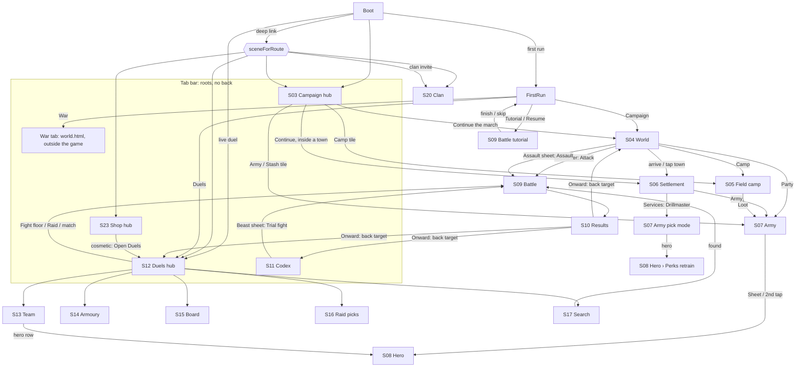

# Screen Flow (v5)

> **Status**: In Review (S2-UX-IA)
> **Author**: ux-designer (autonomous)
> **Last Updated**: 2026-10-10
> **Platform Target**: Telegram Mini App, portrait, touch first
> **Template**: UX Spec (flow)
> **Built from**: docs/v5/audit/NAV.md (every `scene.start`, `goTab`, back handler and `sceneForRoute`), changed by the IA rules (removed with design/ux; see git history)

Every screen, how you get in, how you get out, and where Back goes. "Back" means the top-left arrow in a browser and Telegram's BackButton inside Telegram (`BaseScene.screen({back})`); they always do the same thing.

## 1. Screen register

**24 screens** (full-screen destinations) and **68 sheets and pages** (overlays that keep the screen under them). C- and M- ids refer to the removed design/ux screen specs (git history); the Battle HUD is in docs/UI_KIT.md "Battle HUD".

| ID | Screen | Scene (code) | Kind | Spec |
| --- | --- | --- | --- | --- |
| S01 | Boot | `Boot` | transient | C-1 |
| S02 | First run (offer, resume, reward, modes) | `FirstRun` | onboarding | C-2 |
| S03 | **Campaign hub** | `Menu` | hub (root) | C-3 |
| S04 | **World map** | `World` | sub-screen | C-4 |
| S05 | Field camp | `Camp` | sub-screen | C-5 |
| S06 | Settlement (village, town) | `Settlement` | sub-screen | C-6 |
| S07 | Army (campaign) | `Army` | sub-screen | C-7 |
| S08 | Hero (campaign and duel sources) | `Hero` | sub-screen | C-8 |
| S09 | **Battle** (deployment, fight, tutorial) | `Battle` | full-screen game | C-9 + hud.md |
| S10 | **Results** (incl. Victory variant) | `Results` | sub-screen | C-10 |
| S11 | Codex hub | `Codex` | hub (root) | M-1 |
| S12 | Duels hub: Ladder · Arena | `Duel` (`tab` ladder/ranked) | hub (root) | M-2 |
| S13 | Duels › Team | `Duel` view `team` | sub-screen | M-3 |
| S14 | Duels › Armoury | `Duel` view `shop` | sub-screen | M-4 |
| S15 | Duels › Leaderboard | `Duel` arena `board` | sub-screen | M-5 |
| S16 | Duels › Raid picks | `Duel` arena `raid` | sub-screen | M-6 |
| S17 | Duels › Search / Found | `Duel` search state | transient | M-7 |
| S20 | Clan | `OnlineClan` | sub-screen | M-10 |
| S23 | Shop hub: Shop · Pass · Wallet | `Shop` | hub (root) | M-13 |
| S24 | Kit (debug, `?scene=Kit`) | `Kit` | debug, unlinked | M-14 |
| — | ~~Beast trial list~~ | `BeastTrial` | **retired**, merged into S11 (ia.md §4) | — |

**Sheets** (owner screen in brackets): Settings + its pages Notifications, About, New-campaign confirm [any]; sync-adopt notice [S03]; Encounter, **Assault**, **Event card**, **Arc sheet (Lairs · Journal)**, Strike-camp confirm [S04]; Build drawer, Temper, Muster, Strike confirm [S05]; Recruit card, Item card, Sell confirm, Buy confirm [S06]; Item card / compare, Dismiss confirm [S07]; Perk sheet, **Retrain confirm**, Dismiss confirm [S08]; Assign groups, Shape, **Works tray**, **"more" medallions**, **Battle menu (⋯)**, Leave confirm, Retreat confirm, Tutorial skip confirm, **Doctrine popover** [S09]; **doctrine (i) page** inside the Encounter and Assault sheets [S04]; Inspect [S10]; **Beast sheet**, **Doctrine sheet** [S11]; Level, Floor, Chest preview, Defence, Raid log, Season reward [S12]; Preset manage, Recruit, Dismiss confirm [S13]; Compare-with [S14]; Hex panel, Lobby, Boss/lair info, Attack result, Challenge popup, Coach marks [S18]; Recruit, Item card [S19]; Member manage, Join offer, Found-clan prompt [S20]; Offer item card, Buy confirm [S21]; Listing card, Buy confirm, Cancel-listing confirm, Sell form, Town picker [S22]; Cosmetic dialog, Buy confirm, Unlock premium, XP sheet, Purchase confirm [S23]. **Bold** = new in v5.

## 2. Flow map

Tab switches between the five hubs are omitted (every hub ↔ every hub).

## 3. Entries, exits and Back, per screen

"Back →" is where Back goes. "(origin)" means the `back` target the opener passed.

| ID | Entries (from · control) | Exits (to · control) | Back → | Changed from today |
| --- | --- | --- | --- | --- |
| S01 Boot | app start | FirstRun (first run) · Duels (live duel rejoin) · deep link target · Kit (`?scene=Kit`) · Campaign hub | — (nothing tappable) | localized line + logo (BOOT-1) |
| S02 First run | Boot (first run) | Battle tutorial (Tutorial / Resume) · World or Settlement (Campaign card) · Duels hub (Duels card) · War hub (War card) | offer, resume: Close (root) · reward → modes · modes → Campaign hub | three mode cards (FR-3); Skip becomes a text link (FR-2) |
| S03 Campaign hub | tab · Boot · FirstRun back · sync adopt (with notice) | World / Settlement (Continue) · Army (Army tile) · Army › Stash (Stash tile) · Field camp (Camp tile) · Settings (⚙) · tabs | root (Close) | status line adds "Lairs n/6"; sync badge only on error (MENU-4) |
| S04 World | Hub Continue · Settlement Leave/back · Camp back/Strike · Results Onward · Battle Leave (band fight) | Army (Party) · Field camp (Camp) · Settlement (arrive/tap) · Battle (Encounter Attack, Assault) · Arc sheet (chip) · Settings (⚙) | Campaign hub | Encounter and Assault are Mosaic decision sheets; arc chip; ⚙ added (D9) |
| S05 Field camp | Hub Camp tile · World Camp | World (back, Strike, encounter on End day) · Army › Stash (Loot) · Settings | World | title "Field camp"; Build drawer (CMP-1) |
| S06 Settlement | World (arrive, tap the town you stand on) · Hub Continue (inside) | World (Leave) · Army (Army) · Army pick → Hero retrain (Drillmaster, towns) · Recruit/Item cards | World | Leave becomes bronze (SET-3); town "Services" tab with the Drillmaster |
| S07 Army | Hub Army/Stash tiles · World Party · Settlement Army · Camp Loot · Drillmaster (pick mode) | Hero (Sheet, 2nd tap) · Dismiss confirm · item cards | (origin): Hub / World / Settlement / Field camp | **footer back removed**; Back always to the origin (N3, D8) |
| S08 Hero | Army (Sheet, 2nd tap) · Duels Team row · Drillmaster pick | Perk sheet · Retrain confirm · Dismiss confirm | (origin): Army {heroId} (incl. Army pick mode, whose own Back then returns to the Settlement) / Duels Team | pager below the niche (HRO-4) |
| S09 Battle | World (Attack, Assault) · Codex Trial fight · FirstRun tutorial · Settings Tutorial Replay · Duels (floor, raid, match) · War (Attack, Raid it) | Results (end, retreat) · (origin) (Leave in deployment) · tutorial skip/finish: FirstRun on the first run; a **replay** from Settings returns to the screen Settings was opened from | battle menu (⋯); in the tutorial ⋯ shows Skip tutorial, not Retreat | Leave in deployment returns to the **origin**, never to Army without data (N2) |
| S10 Results | Battle | (origin) via Onward | Spoils tab first if unseen, then Onward (N8) | Victory variant; why line; trial → Codex (N1) |
| S11 Codex | tab · War boss panel "Codex ›" (tab switch, sheet open) · Results (trial, sheet open) | Beast sheet → Battle (Trial fight) · Doctrine sheet | root (Close); a sheet's X lands on the Codex hub | absorbs BeastTrial (V5-015) |
| S12 Duels hub | tab · Boot (rejoin) · Shop cosmetic "Open Duels" · Results (duel) | Team · Armoury · Board · Raid picks · Search · Battle (Fight floor, Raid) · sheets | root (Close); **no back arrow** (D12) | Team/Armoury in one row with the chips (DUE-1); "Open in Telegram" when outside (DUE-9) |
| S13 Team | Duels hub Team | Hero (row) · Recruit · Dismiss (bench row, new) | Duels hub (the view it came from) | no Armoury cross-link (D11); preset tools in a sheet (DUE-5) |
| S14 Armoury | Duels hub Armoury | Compare-with sheet · buy/sell confirms | Duels hub | renamed from "Shop" (D2) |
| S15 Leaderboard | Arena Top / Board buttons | — | Arena | title follows the segment (DUE-2) |
| S16 Raid picks | Arena Raid | Battle (Raid {name}) | Arena | — |
| S17 Search / Found | Arena Find match | Battle (found) · Arena (Cancel) | **Cancel only**, no back arrow (N5) | — |
| S20 Clan | pending invite · deep links `clan_<code>`, `myclan` | Telegram share (Invite) · Member manage | Campaign hub | i18n (CLN-1) |
| S23 Shop hub | tab · War army Shop (tab switch) · "Need n Dr" (tab switch to Wallet) · deep link `wallet` | Market (card) · Duels hub (cosmetic Open Duels) · Telegram Stars payment | root (Close), always: no back arrow even through a door | Market card; pinned season card (SHP-1) |
| S24 Kit | `?scene=Kit` only | — | Campaign hub | unchanged, unlinked |

## 4. Decision sheets: what Back does

| Sheet | Choices | Back = | Shown on the sheet |
| --- | --- | --- | --- |
| Encounter (World) | Attack (primary) · Take ransom · Let them go / Flee n% | "Let them go"; if the band hunts you: shake + highlight Flee | "They won't let you go" when it applies |
| Event card (World) | 2-3 choices, one free (campaign-events.md R4.5) | the free choice, after a confirm "Choose: {label}?" | never auto-picks a costed choice |
| Leave deployment / Retreat / Reset all / Dismiss / New campaign / Strike camp / Cancel listing / Skip tutorial | Confirm (destructive) · Cancel | Cancel | — |

The **Assault** sheet is not a decision sheet: it is optional (X, Back and tap outside = Leave).

## 5. Dead-end check

Every screen and state, and its way out. A "✓" means checked against this document's tables.

| Screen / state | Way out | ✓ |
| --- | --- | --- |
| Boot (load error) | today: none. **New:** "Couldn't load. Retry" button | ✓ |
| First run, any step | primary CTA; reward/modes back to the hub | ✓ |
| Campaign hub, no save | "Begin the march" → World | ✓ |
| World, encounter open | the sheet's choices (§4) | ✓ |
| World, event open (map paused) | the card's choices; one is free | ✓ |
| World, "No way there" | banner expires; map stays live | ✓ |
| Camp, no camp pitched (field) | auto-return to World (as today) | ✓ |
| Settlement, sacked (campaign-arc R2.3) | Hire/Buy show "Sacked: reopens in n days"; Services and Leave stay | ✓ |
| Army, empty roster (destroyed army) | empty state "Volunteers wait in {town}" + Back | ✓ |
| Hero, last hero dismissed | blocked: Dismiss disabled on the last fit hero with a reason | ✓ |
| Battle, any phase | battle menu (⋯): Leave / Flee; Results at the end | ✓ |
| Results, any tab | Onward always visible | ✓ |
| Codex, no doctrine met yet | Beasts segment only; every beast entry opens (lore + Trial) | ✓ |
| Duels hub: loading / offline / closed / error / outside | Retry; outside: "Open in Telegram"; tabs stay | ✓ |
| Duels search | Cancel | ✓ |
| War hub: loading / unavailable / join | Retry / "Open in Telegram" / Join; tabs stay | ✓ |
| Clan: none / offline / error | Found a clan / Retry; Back | ✓ |
| Market: empty browse / no listings | empty state + "Sell" tab link; Back | ✓ |
| Shop: loading / outside / offline / closed / error | Retry; outside: "Open in Telegram"; tabs stay | ✓ |
| Cloud-sync adopt | lands on the Campaign hub with a notice (N9) | ✓ |

**NAV.md findings closed:** N1 (§4 ia, S10), N2 (S09), N3 (S07), N4 (S22), N5 (S17), N6 (§4), N7 (S12, S18), N8 (S10), N9 (§5), N10 (S13); D1 (origin-derived back), D2 (ia §5), D3 (ia §4), D4 (one home, ia §3), D5 (S22), D6 (one Army template, C-7), D7 (S05), D8 (ia §5), D9 (⚙ everywhere), D10 (S02), D11 (S13), D12 (hubs).

## 6. Acceptance Criteria

- [ ] Every edge in §3 is reproducible in a build, and Back from each multi-door screen returns to the screen that opened it.
- [ ] Every state in §5 shows its exit at 320x568.
- [ ] Market opened from the bot deep link returns to the Shop hub.
- [ ] A Trial fight from a War "Codex ›" door ends on the Codex beast sheet, with the Codex tab lit.
- [ ] A tutorial replay from Settings returns to the screen Settings was opened from.
