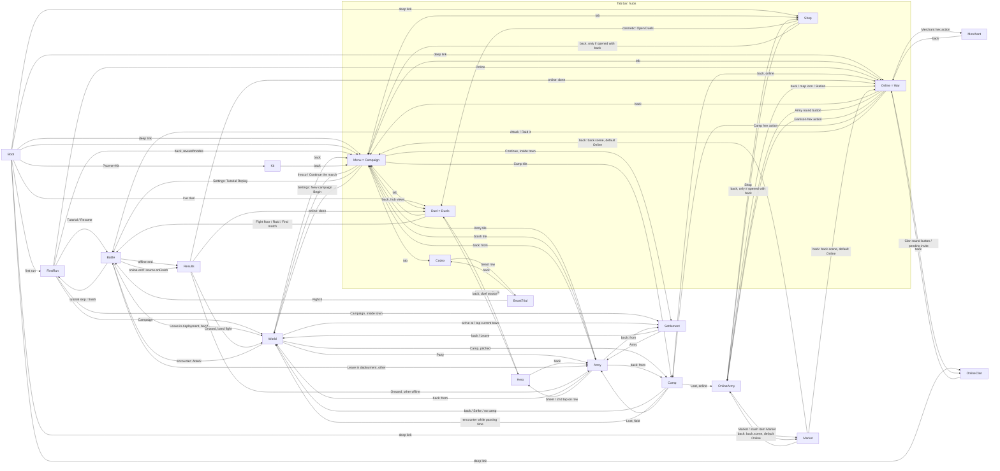

# v5 audit: the navigation graph

Story S1-AUDIT-UI. Built on 2026-10-10 from the code on branch `v5` @ ea5af21: every `scene.start` / `restart`, `goTab` (`src/ui/mosaic/hub.ts:15`), the back handlers and `sceneForRoute` (`src/online/deeplink.ts:64`). Each edge below names the control that triggers it. Screenshots are in `shots/` (see UI.md).

**Back:**
- **Inside Telegram** the in-game back arrow is hidden (`inGameBack`) and the Telegram header BackButton does the same job (`BaseScene.screen({back})`).
- **In a browser** the top-bar arrow is shown.
- **Hub tabs are roots.** Telegram shows Close there.

## 1. Graph

## 2. Edge table (scene → scene, with the triggering control)

| From | Control | To (data) | Source |
| --- | --- | --- | --- |
| Boot | auto | Duel `{tab:'ranked', rejoin}` / FirstRun `{mode}` / deep link / Kit / Menu | BootScene.ts:67-82 |
| Boot | deep link `market` | Market `{back:{scene:'Menu'}}` | deeplink.ts:75 |
| Boot | deep link `wallet` | Shop `{tab:'wallet', back:{scene:'Menu'}}` | deeplink.ts:82 |
| Boot | deep link `settings` | Menu `{settings:'notify'}` (opens Settings and Notifications) | deeplink.ts:80 |
| Boot | deep link `loc_/boss_/duel/income/season/invite` | Online `{focus, select}` / `{lobby:true}` / `{}` | deeplink.ts:67-79 |
| Boot | deep link `clan` | OnlineClan | deeplink.ts:76 |
| any hub | tab bar Campaign / Duels / War / Codex / Shop | Menu / Duel / Online / Codex / Shop | hub.ts:15-23 |
| any scene | Telegram ⋯ → Settings | Settings sheet (pauses an offline battle) | BaseScene.ts:79 |
| FirstRun offer/resume | Tutorial (recommended) / Resume tutorial | Battle `{tutorial:{}}` | FirstRunScene.ts |
| FirstRun offer/resume | Skip (→ confirm on resume) | FirstRun `{mode:'modes'}` | FirstRunScene.ts:160 |
| FirstRun reward | Continue | FirstRun `{mode:'modes'}` | |
| FirstRun modes | Campaign / Online | Settlement or World / Online | |
| FirstRun reward/modes | back arrow | Menu | |
| Menu | fresco or "Continue / Begin the march" | Settlement `{id}` if inside a town, else World | MenuScene.ts:157-163 |
| Menu | Army tile / Stash tile | Army `{from:'Menu'}` / `{from:'Menu', tab:'stash'}` | MenuScene.ts:90-91 |
| Menu | Camp tile (enabled only with a camp) | Camp `{mode:'field'}` | |
| Settings | Tutorial Replay/Resume | Battle `{tutorial:{replay}}` | settings.ts |
| Settings | New campaign → Begin | World (after reset) | settings.ts:223 |
| Settings › About | Terms / Privacy / Refund | external browser | notifySettings.ts:136 |
| World | top back | Menu | WorldScene.ts:1026 |
| World | Party | Army `{from:'World'}` | |
| World | Camp (when pitched) | Camp `{mode:'field'}` | |
| World | arrive at / tap the town you stand on | Settlement `{id}` | WorldScene.ts:1036 |
| World | encounter Attack | Battle (no data; `state.pending`) | WorldScene.ts:1292 |
| Camp (field) | back / Strike → confirm / no camp | World | CampScene.ts:178, 1001 |
| Camp (field) | End day, and an encounter happens | World `{encounter}` | CampScene.ts:955 |
| Camp | Loot (amphora) | Army `{from:'Camp', tab:'stash'}` / OnlineArmy `{tab:'stash'}` | CampScene.ts:1056 |
| Camp (online) | back | `back.scene` (Online `{focus, select}`) | CampScene.ts:196 |
| Settlement | back / Leave | World | SettlementScene.ts:146 |
| Settlement | Army | Army `{from:'Settlement', id}` | |
| Army | top back / footer "Map/Town/Camp" | Settlement / Camp / `from` (World or **Menu**) | ArmyScene.ts:116-121, 221 |
| Army | Sheet / tap the selected row | Hero `{heroId, back}` | ArmyScene.ts:124 |
| Hero (campaign) | back | Army `{...from, heroId}` | heroSource.ts:58 |
| Hero (duel) | back / after Dismiss | Duel | duel/heroSource |
| Battle (deploy, offline) | Leave → confirm | World `{encounter}` for a band fight, else **Army (no data)** | BattleScene.ts:1374 |
| Battle (online) | Leave / Ready / end | `src.onLeave` / `src.onFinish` → Results → `done()` | battleSource.ts |
| Battle | Flee → Retreat | Results (retreat) | BattleScene.ts:2833 |
| Battle (tutorial) | Skip → Skip / finish / defeat | FirstRun `{mode:'modes'}` / `{mode:'reward'}` / restart | battleTutorial.ts:709-737 |
| Results (offline) | Onward / system Back | World (band fight) or Army `{from:'World'}` | ResultsScene.ts:693-712 |
| Results (online) | Onward | the source's `done()`: Online `{focus}` or Duel `{tab, result}` | ResultsScene.ts:758 |
| Codex | beast row | BeastTrial `{from:'Codex', open}` | CodexScene.ts:40 |
| BeastTrial | back | `from` (Codex; default Menu) | BeastTrialScene.ts:38 |
| BeastTrial | Fight it | Battle → Results → **Army → World** | BeastTrialScene.ts:90 |
| Shop | cosmetic "Open Duels" | Duel `{tab:'ranked'}` | ShopScene.ts:293 |
| Shop | cosmetic "Open Pass" / "Get Drachmae" | same scene, tab switch | |
| Shop | back (only with `back`) | `back.scene` | ShopScene.ts:104 |
| Online | back (closes the modal, then the selection, then) | Menu | OnlineScene.ts:303 |
| Online | Army round button / Garrison hex action | OnlineArmy `{}` / `{garrison:h}` | OnlineScene.ts:596, 934 |
| Online | Clan round button / pending invite | OnlineClan | OnlineScene.ts:328 |
| Online | Merchant / Camp hex actions | Merchant `{loc, back}` / Camp `{mode:'online', back}` | OnlineScene.ts:832-883 |
| Online | Attack / Raid it | Battle `{source}` → Results → Online | OnlineScene.ts:1394 |
| Online | Lobby → Challenge, then accepted | Battle `{source: duel}` (any `Online*` scene) | duelInvites.ts |
| OnlineArmy | back / map icon / Station | Online `{focus}` | OnlineArmyScene.ts:88, 518 |
| OnlineArmy | Market / stash item "Market" | Market `{back:{scene:'OnlineArmy'}}` / `{tab:'sell', back}` | OnlineArmyScene.ts:372, 425 |
| OnlineArmy | Shop | Shop `{back:{scene:'OnlineArmy'}}` | |
| OnlineClan | back | Online | ClanScene.ts:44 |
| OnlineClan | Invite → Share | Telegram share sheet (external) | |
| Merchant | back | Online `{focus, select}` | MerchantScene.ts:112 |
| Market | back | `back.scene` (default **Online**) | MarketScene.ts:120 |
| Duel | back (hub views) | Menu | DuelScene.ts:331 |
| Duel | back (sub-views: Team, Shop, Board, Raids) | `up()` → the last mode | |
| Duel | Team hero row | Hero `{source: DuelHeroSource}` | DuelScene.ts:2377 |
| Duel | Fight floor / Raid / Find match | Battle `{source}` → Results → Duel `{tab, result}` | DuelScene.ts:2770-2789 |
| Kit | back | Menu | KitScene.ts:39 |
| (cloud sync adopt) | automatic | **Menu**, from anywhere except battle and duel | main.ts:95 |

## 3. Dead ends and stranding

| ID | Path | Problem | Sev |
| --- | --- | --- | --- |
| N1 | Codex → BeastTrial → Fight it → Battle → Results → **Army → World** | A trial fight never returns to the Codex. The player is dropped into the campaign map and its back chain, far from where they started. | major |
| N2 | Battle (offline, not a band fight) → Leave in deployment → **Army with no data** | Army's `from` defaults to World, so Back goes to the World map even when the fight started from the Trial. | minor |
| N3 | Menu → Army (`from:'Menu'`) | The footer back button **says "MAP"** but goes to the Menu (ArmyScene.ts:221 knows only Settlement and Camp). The label lies. | major |
| N4 | Boot deep link `market` → Market → back | Goes to Menu. Fine. But Market opened from OnlineArmy, then Back → OnlineArmy → back → Online: three levels deep for a top-level economy feature. | minor |
| N5 | Duel search | A back arrow is drawn, but Back is refused ("Cancel the search first"). It looks like an exit that is not one. | minor |
| N6 | World encounter dialog | There is no close control. Back is refused unless you pick "Let them go", and that is not stated. | minor |
| N7 | Online "unavailable" (outside Telegram) and Duel "outside" | Honest states, but the only action is "Back to menu" (War), or none at all (Duels). There is no link to open the bot. | minor |
| N8 | Results (offline): system Back | Silently takes the picked spoils and leaves (`screen({back: finish})`). There is no way to go back to choose. | minor |
| N9 | Cloud-sync adopt (main.ts:95) | Any screen outside battle and duel jumps to the Menu with no notice when a newer save arrives. | minor |
| N10 | Duel Team, recruit when the roster is full | The reason says "dismiss someone first", but Team has no Dismiss. It lives on the Hero sheet footer only (`openDismiss` is never called). | minor |

## 4. Duplicated or confusing paths

| ID | What | Where | Sev | Direction |
| --- | --- | --- | --- | --- |
| D1 | **Army reached 4 ways with different back targets:** Menu tiles (Army, Stash), World Party, Settlement Army, Camp Loot, Results, Battle Leave. | Army | minor | Fine as a hub, but derive the back label from the actual origin (N3). |
| D2 | **Five "shops":** the Shop hub (cosmetics, pass, Drachmae); the Duels "Shop" (Glory gear, top bar "SHOP"); the Market (player trade); the Merchant (map merchant); the Settlement Buy tab. Plus "Get Drachmae" → Wallet. | Shop, Duel, Market, Merchant, Settlement | major | Name them by currency or role ("Treasury" / "Armoury" / "Agora" / "Merchant" / "Town stalls"), give each a distinct icon, and link the Market from the Shop hub. |
| D3 | **Codex and BeastTrial list the same beasts with the same rows.** Codex is a tab whose only content is a link list into BeastTrial. | Codex, BeastTrial | major | Merge: Codex is the bestiary, and the beast sheet has the Fight action. |
| D4 | **The same stash grid in 5 places:** Army › Stash, Hero › Gear, Settlement › Sell, OnlineArmy › Stash, Duel › Shop › Sell. Plus the Menu "Stash" tile, which is just Army with `tab:'stash'`. | several | minor | One component is right. But the Menu Stash tile and Hero Gear duplicate Army › Stash: keep one entry per army. |
| D5 | **The player Market is reachable only via War › Army › Market** (or a bot deep link). The Shop hub only mentions "map merchants". | Market | major | Add Market to the Shop hub (and to towns). |
| D6 | **Two armies, two army screens:** Army (campaign) and OnlineArmy (war), plus the Duel Team roster (a third army) sharing the Hero scene. The screens look alike but differ in slot order, Lv pill colour, chip icons (heart for food) and footers. | Army, OnlineArmy, Duel Team, Hero | major | One Army screen template with a source (campaign / war / duel), as Hero already does with `HeroSource`. |
| D7 | **Camp has two meanings:** the campaign field camp (Menu tile, World) and the War home or forward camp (Online hex action). Same scene, different chips, buildings and actions. | Camp | minor | Different titles and icons ("Field camp" / "War camp"); the Menu Camp tile only for the field camp. |
| D8 | **"Back" is three things:** navigation back, the battle order "Back" (fall back), and the Army footer back labelled Map/Town/Camp. | Battle, Army | minor | Rename the order to "Fall back". The footer back should be either a label or the top arrow, not both. |
| D9 | **Settings is reachable 3 ways:** the gear in the hub top bars, the Telegram ⋯ menu, and the deep link. The gear is missing on map scenes (World, Camp) and in Battle. | Settings | minor | Consistent gear placement, or document that the ⋯ menu covers it. |
| D10 | **FirstRun "Two ways to fight" vs three tabs** (Campaign, Duels, War). | FirstRun | major | See UI.md FR-3. |
| D11 | Duel **Team ↔ Shop** buttons on each other's headers make a loop. Back from either goes to "the last mode", not to the previous view. | Duel | minor | Sub-views come from the hub only; Back goes to the previous view. |
| D12 | **War back → Menu**, while the Campaign tab is also on screen: two controls with the same effect. Duels too. | Online, Duel | minor | Hubs are roots: no back (as the spec says); Telegram shows Close. |

## 5. Unreachable or dead UI found in code

- `OnlineScene.openCampPanel()` / `campPanel.ts`. It was replaced by the Camp scene (OnlineScene.ts:855).
- `DuelScene.openDismiss()` (DuelScene.ts:2444).
- The battle radial order ring (`this.ring` is never assigned; BattleScene.ts:195). The copy still mentions it (`battle.sit.quiet`).
- WorldScene's placement path (`placing` is never set) and the "tap Build" banner (WorldScene.ts:777).
- `src/scenes/online/common.ts`: `addResourceBar`, `resourceLine`, `MINE_COLOR`, `CLAN_COLOR` are unused.
- KitScene is debug only (`?scene=Kit`) and is not linked from any menu. That is correct.
