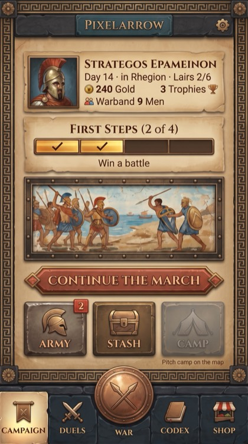
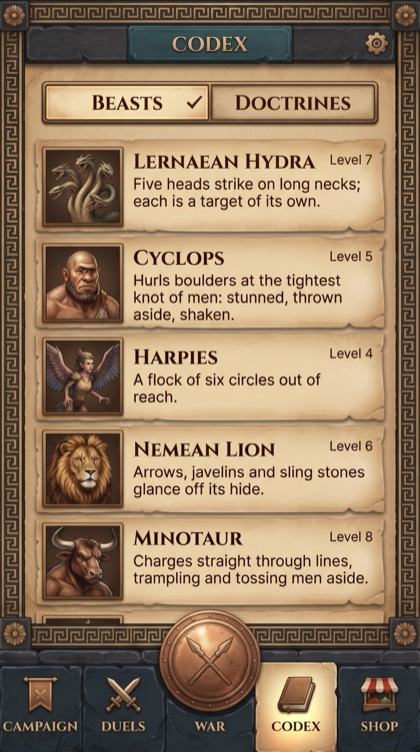
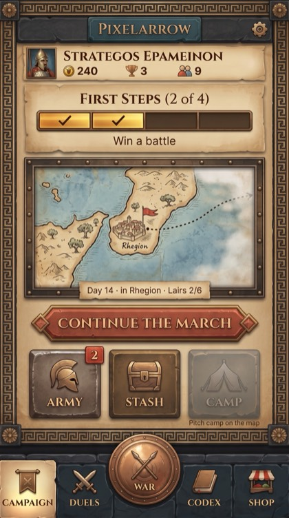
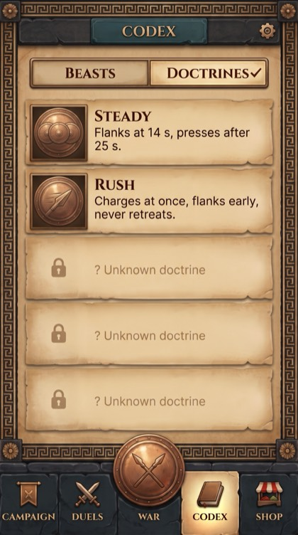
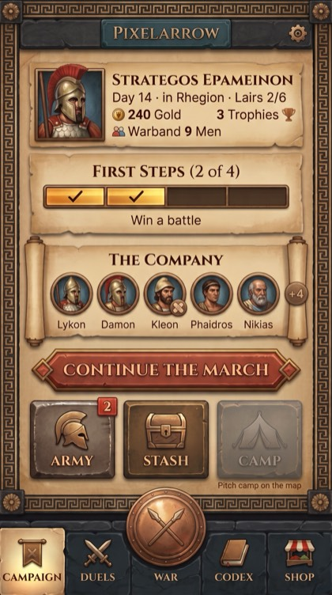
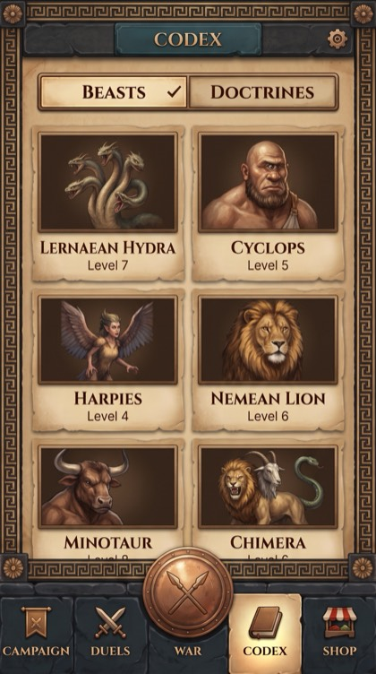

# Hub pick: A, B or C (AS-01)

Story AS-01, 2026-10-10. The assets agent rendered the three directions of [HUB_DIRECTIONS.md](HUB_DIRECTIONS.md) in Gemini and reviewed them with `/ux-review`. **This is a recommendation; the Director makes the pick and logs it in DECISIONS.md.** Prompts, raw files and every verdict are in [ASSET_LOG.md](../ASSET_LOG.md) › Done › AS-01.

**Recommendation: Direction A, "Fresco Hall".** The reasons are in §4.

## 1. The renders

| | Campaign hub | Codex hub |
| --- | --- | --- |
| **A Fresco Hall** |  |  |
| **B War Table** |  |  |
| **C Muster Roll** |  |  |

Raws (1536x2752, untouched): `docs/v5/gemini/AS-01/`. The B Codex shows the Doctrines segment and the A and C Codex show Beasts, as their prompts asked; the three Codex layouts are list (A), manual-page list (B) and two-column grid (C).

**Allowlist check.** Every accepted render was compared tile by tile with its allowlist. None shows an invented feature (no Quests, mail, energy, Play button, XP bar, gems, leaderboard, Units or Lore). Two renders were rejected and redone as edits: C's "+4" painted onto Nikias's portrait (it read as a stat), and B's doctrine icons reusing the War medallion glyph. Details in ASSET_LOG.

**Caveat.** A mockup is a picture of a layout, not proof that it fits: Gemini fills a 9:16 canvas (1536x2752), not 390x844, and does not measure text. The width analysis below is reasoned from the renders' proportions and the C-3 spec, not measured in the game.

## 2. UX review

`/ux-review` is written for UX spec documents (checklists 3A/3B/3C). Here it is applied to three *directions* of one already-specified screen, C-3 in `design/ux/screens-campaign.md` (checklist **3A, assumed**: the directions are variants of a UX Spec screen). Completeness items (header, states, events, data) belong to C-3 itself, which all three directions share, so they are not re-scored. The four review dimensions are scored per direction.

**Inputs loaded:** `design/ux/screens-campaign.md` C-3 (the IA), `docs/v5/ux/ELEMENT_MAP.md` §1.2 and §1.5, `design/ux/interaction-patterns.md` (present), `design/accessibility-requirements.md` (present: **Standard tier**, V5-013), `design/art/art-bible.md`, DECISIONS V5-029, V5-030, V5-045. **Platform** (from C-3's header): Telegram Mini App, portrait, touch first, mouse second; keyboard and gamepad out of scope.

### 2.1 IA and GDD alignment (C-3, ELEMENT_MAP)

| Check | A | B | C |
| --- | --- | --- | --- |
| E003–E018 all present (plaque, ⚙, tabs, profile portrait, name, status line with Lairs n/6, gold/trophies/men, first steps, fresco slot, CTA, Army/Stash/Camp tiles) | ✓ | ✓ (status moved onto the map cartouche) | ✓ |
| Nothing from the never-show list | ✓ | ✓ | ✓ |
| Information hierarchy of C-3 (1 verb, 2 status line, 3 Army badge, 4 resources, 5 fresco) | ✓ exactly | **Changes it**: place first, and the status line becomes part of the illustration | ✓; the roll adds a 6th item between status and verb |
| Fresco slot is one tappable door (= Continue) | ✓ | ✓ (map = Continue) | **Changes the door**: the roll opens Army, a second door to Army next to the Army tile (allowed by V5-029 "many doors", but two adjacent doors to one place) |
| Profile E009–E012 "Kept" | ✓ | Gold, Trophies, Men lose their words ("240", "3", "9"): numbers with icons only | ✓ |
| Codex E064–E067 (thumbnail, name, **hint 1, two lines**, level) "Kept" | ✓ list keeps the hint | ✓ (Doctrines) | **Gap**: the grid drops the hint line (E066); it would have to move to the beast sheet, which ELEMENT_MAP does not say |
| New data or assets needed | none: ART-001 `fresco_campaign` is already listed | **new art**: no region map exists in ASSET_LIST; one per region, plus code-set lettering (no text in paintings, ASSET_LOG rules) | **owner OK needed** (HUB_DIRECTIONS §2): new presentation of roster data; and the faces: per-hero painted faces do not exist, class busts (ART-012…) are per class, and V5-045 keeps each hero's own face on hero cards |

**GDD alignment:** A ALIGNED; B GAPS (hierarchy change, status inside art, resource labels dropped); C GAPS (owner OK, Codex hint, portrait source).

### 2.2 Small screens: how each reflows at 360 and 320

Reference widths: the content well inside the meander frame is about 330 pt at 390 wide, about 300 at 360 and about 260 at 320. C-3 rule MENU-1: under VH 700 (320x640, 320x568) the fresco collapses to a one-line banner and Army, Stash and Camp stay above the fold. Measured from the renders, the fresco slot is about 113 pt tall at 390x844.

| | 360x780 | 320x640 / 320x568 |
| --- | --- | --- |
| **A** | Same stack, everything a little narrower. Status line "Day 14 · in Rhegion · Lairs 2/6" (32 chars) fits one line; wraps cleanly to two if longer (C-3 allows ≤ 48 chars). | The fresco becomes the one-line banner (already specified and built; layout-check covers 320x640 since LF-03). The tiles stay above the fold. **No new rule needed.** |
| **B** | The map (about 165 pt, the tallest slot of the three) plus the slim strip roughly equals A's height. The strip "STRATEGOS EPAMEINON  ◎240 🏆3 👥9" is tight at 300 pt in Cinzel caps; a longer name pushes the numbers to a second line, which undoes the "slim strip". | The map must collapse to keep the tiles above the fold, and **the status line goes with it** (it lives on the map's cartouche). B then needs a second layout that puts the status back in the strip: two layouts for one screen. The cartouche cannot wrap to two lines on the map edge without covering the art. |
| **C** | Five 52 pt portraits plus the "+4" disc already touch the scroll's roller at 390 (see the render). At 300 pt: drop to 4 faces + "+5". "Phaidros" in Inter 13 px is about 55 px wide, wider than a 50 pt slot: names start to collide. | At 260 pt: 4 slots of about 50 pt with 13 px names is the floor, or 3 faces. The roll is about as tall as the fresco, so under VH 700 it must collapse too, and there is no one-line form of "a row of faces" that keeps faces at the 21 UI px read size and 44 pt targets. Under the tiles rule, C loses its own idea on the phones that need the space most. Codex grid: "LERNAEAN HYDRA" in Cinzel caps does not fit a 125 pt card at 320 and must wrap (G14 forbids ellipsis). |

### 2.3 Accessibility (Standard tier, V5-013)

| Check | A | B | C |
| --- | --- | --- | --- |
| No state by colour alone | ✓ Camp grey + caption; badge has a number | ✓ | ✓ wounded = bandage glyph, not a tint |
| Text ≥ 13 CSS px, contrast ≥ 4.5:1 | ✓ (all text on parchment) | **Risk**: the status line sits on a cartouche over painted art (§3: text on parchment or a solid plaque only; a cartouche must be a solid plaque, not a translucent label) | **Risk**: 5 names under 50 pt faces at 13 px is the minimum with no slack for the +40% ru expansion rule |
| Targets ≥ 44 pt, ≥ 8 pt apart | ✓ one big slot | ✓ | **Risk**: if each face is tappable (to a hero), 5–6 targets in 260–330 pt fall under 44 + 8; if only the whole roll is tappable, the faces look like buttons that are not |
| Every meaningful icon has text | ✓ | **Gap**: ◎240 🏆3 👥9 drop "Gold", "Trophies", "Men" | ✓ |
| Disabled reads as disabled with a reason | ✓ Camp caption | B Codex: faded "? Unknown doctrine" rows are probably below 4.5:1 in the render; the build must keep the reason text at contrast and fade only the icon (all directions share this Codex rule) | ✓ |

**Accessibility:** A COMPLIANT (at mockup level); B GAPS; C GAPS.

### 2.4 Art bible

All three keep the locked look (meander frame, parchment, teal plaque, terracotta single primary, bronze tiles, grey Camp only), so all pass §4.2 colour jobs. Shared deviations to fix in code, not in a re-render: mixed-case Cinzel on "First Steps (2 of 4)" (§7.2 caps only); the badge has no cream ring (§7.3). P1 "painted chronicle, pixel battlefield": A's fresco and C's busts are painted reading art, fine. B's map is painted but **looks like the playable World map**, which is pixel art one tap away: two maps of one place in two media blurs P1, and players may expect to scroll or tap the painted one. **Pattern library:** CONSISTENT for A; B and C each add a new component (map vignette with cartouche; muster roll) that interaction-patterns.md does not have yet.

### 2.5 Verdicts

| Direction | Verdict | Blocking | Advisory |
| --- | --- | --- | --- |
| **A Fresco Hall** | **APPROVED** (as a direction) | 0 | 2 (caps on First Steps; badge ring) |
| **B War Table** | NEEDS REVISION | 3 (status line lost on compact screens; resources without labels; new region-map art per region) | 2 (P1 two maps; new pattern) |
| **C Muster Roll** | NEEDS REVISION | 3 (owner OK and portrait source per V5-045; no compact form under VH 700; Codex grid drops hint E066) | 2 (second door to Army next to the Army tile; name width at 320 and in ru) |

Dimensions not assessed: none.

## 3. What is good in B and C (worth keeping later)

- **B's map vignette** answers "where are we?" beautifully. It could live on the World map's own entry, or replace the fresco only on screens taller than VH 800, once a region-art row is in ASSET_LIST.
- **C's muster roll** is the strongest expression of pillar P4 ("Every man has a name"). It fits better **inside the Army screen** (its home), where there is room and the faces already have a source (V5-045 hero portraits), than on the hub. Any hub use needs the owner's OK first (HUB_DIRECTIONS §2).
- **B's slim profile strip** saves about 50 pt. It is not recommended for A as is, because it drops the resource labels; a two-line strip with labels could be tried in HUB-02 if 320x568 is tight.

## 4. Recommendation: A, "Fresco Hall"

1. **It is C-3 exactly.** Every ELEMENT_MAP §1.2 row in its specified place and order, with the information hierarchy the IA chose (verb, status, badge, resources, mood). HUB-02 acceptance 1 is met by construction.
2. **It already reflows.** The compact rule (fresco → one-line banner under VH 700, tiles above the fold) is specified and covered by layout-check at 320x640. B and C would each need a second layout and a new rule that drops their own idea on small phones.
3. **No new art or decision.** `fresco_campaign` (ART-001) is in the asset list; B needs region maps that do not exist; C needs the owner's OK and a portrait source that V5-045 leaves open.
4. **Accessibility is clean at mockup level**: all text on parchment, labelled resources, one 44 pt-plus door per element.
5. **The Codex list keeps the hint line** (E066 Kept) and works at 320, where C's grid would wrap names and drop hints.
6. **Lowest risk for W10** (HUB-02 is one story of 2 expected days).

What the build must still fix on A (from the review): Cinzel caps on "FIRST STEPS (2 OF 4)", the cream ring on the Army badge, the WAR label inside the bar (A's render has it right; B's did not), and doctrine rows whose locked reason text stays at 4.5:1.

## Skills applied

create-game-assets (brief blocks, family seed: A1 as the style reference, inspect-before-save), asset-spec (prompts anchored to the art bible's §4 tokens and §7 rules, solo mode: no agents spawned), asset-audit (sizes measured with `ls`/`sips`: raws 2.7–3.2 MB, previews 88–109 KB; naming, size budget and orphan sections NOT ASSESSED: mockups are not shipped assets and have no manifest rows), art-bible (palette, type, icon and frame rules as the check list), ux-review (checklist 3A assumed, four dimensions, verdicts above); art-director, technical-artist and ux-designer roles applied in this session, not spawned.
